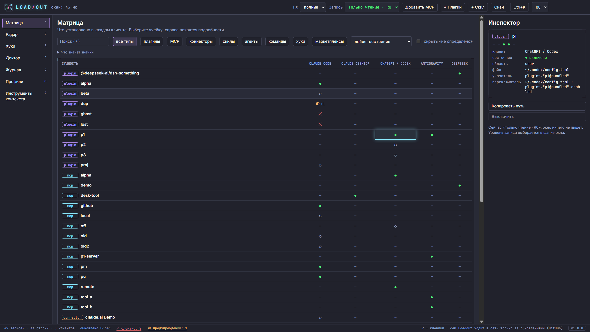
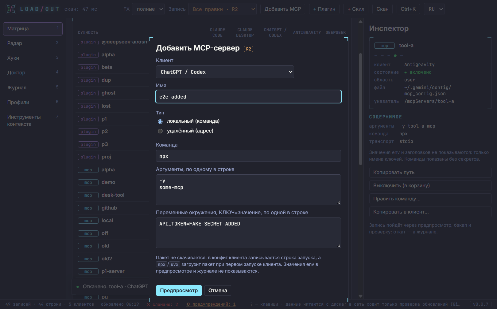
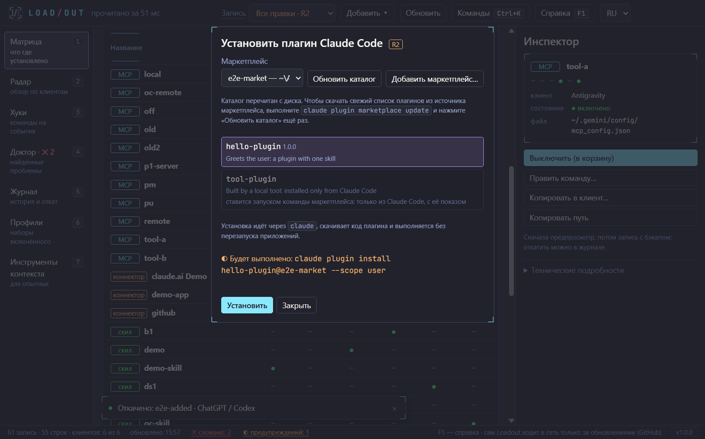
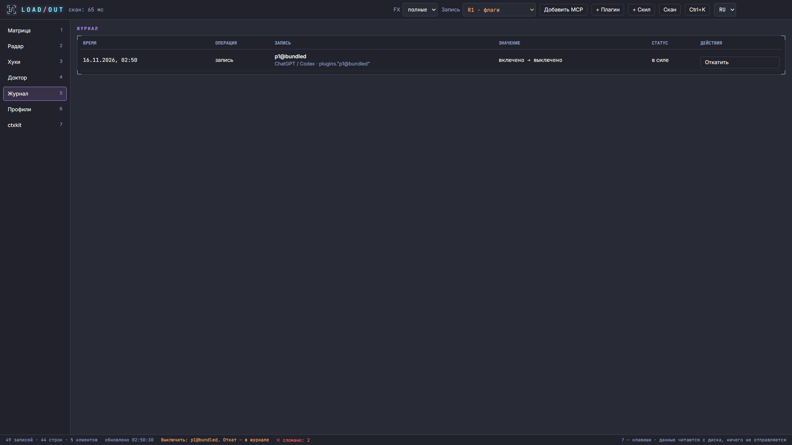
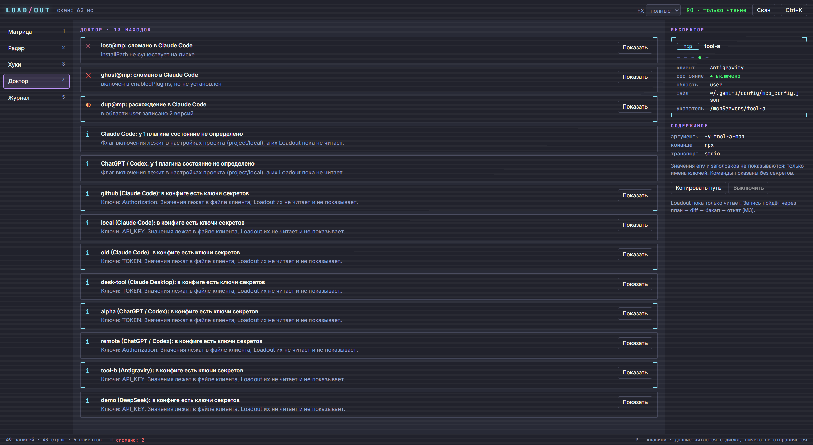
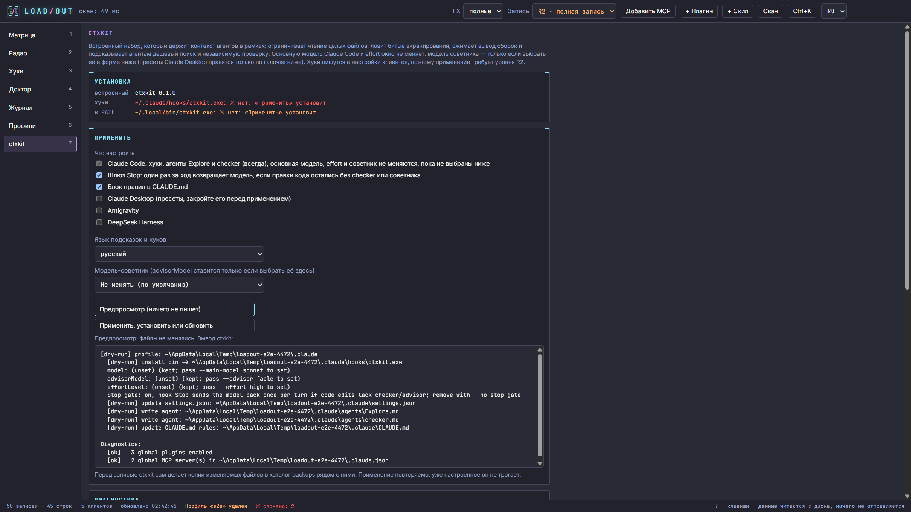

# Loadout

Один экран вместо пяти конфигов. Loadout показывает и меняет плагины, MCP-серверы, скилы, агентов, хуки и команды сразу у пяти клиентов: Claude Code, Claude Desktop, Codex, Antigravity и DeepSeek Harness. Запись точечная и безопасная: предпросмотр, хеш-блокировка, бэкап, журнал, откат.



*Снимки сделаны на тестовых данных из `fixtures/`, не на настоящем профиле.*

## Что умеет

- **Матрица** всех записей по пяти клиентам: включено, выключено, сломано, расхождение версий. Плагины и MCP в отдельных группах. Инспектор записи справа.
- **Включить и выключить** запись (R1); **вынести MCP в корзину, править команду, копировать в другой клиент** (R2). Формат JSON ⇄ TOML ⇄ YAML переводится сам.
- **Добавить MCP-сервер** и **установить плагин Claude Code** прямо из окна. Значения env в окне и журнале не показываются.
- **Профили**: снимок набора включённых записей, применение пакетом, откат пакета целиком.
- **Журнал** каждой записи с откатом. Перед любой записью копия файла уходит в бэкап.
- **Доктор** находит сломанные ссылки, расхождения, дубли, копии конфигов.
- **ctxkit** внутри: установка, применение и счётчики эффективности (см. ниже).
- По умолчанию окно ничего не пишет (R0). Уровень записи повышается в шапке и подтверждается окном системы.

| Добавить MCP | Установить плагин |
|---|---|
|  |  |

| Журнал и откат | Доктор |
|---|---|
|  |  |

## ctxkit

`crates/ctxkit` — набор хуков и диагностики, который держит контекст агентов в рамках: ограничивает чтение целых файлов, ловит битые экранирования, сжимает вывод сборок, переключает рутину на дешёвые модели. Встроен в приложение (раздел «ctxkit»), но ставится и отдельно. Подробности: [crates/ctxkit/README.md](crates/ctxkit/README.md).



## Устройство

| Каталог | Что это |
|---|---|
| `app/` | Приложение (Electron + React, Windows) |
| `crates/loadout-core`, `crates/loadoutd` | Ядро на Rust: скан, запись, сторож файлов, процесс-ядро для окна |
| `crates/ctxkit` | ctxkit (MIT), собирается в том же воркспейсе |
| `docs/CONCEPT.md` | Концепция, решения, итоги этапов и аудитов |
| `fixtures/`, `state/` | Тестовые данные и снимки окна из сценариев e2e |

## Сборка и проверки

```bash
cargo build --release          # ядро и ctxkit (бинари в target/release)
cargo test                     # тесты Rust
cd app && npm install
npm run e2e                    # сборка и сценарии в окне
npm run dist                   # установщик (NSIS, без подписи)
```

`ctxkit.exe` для приложения берётся из `crates/ctxkit` (`npm run bundle:ctxkit`). Подпись установщика и автообновление пока не сделаны: нужны сертификат подписи кода и адрес публикации.

## Лицензии

`crates/ctxkit` — MIT (см. `crates/ctxkit/LICENSE`). Остальное — пока без лицензии (все права сохранены).
