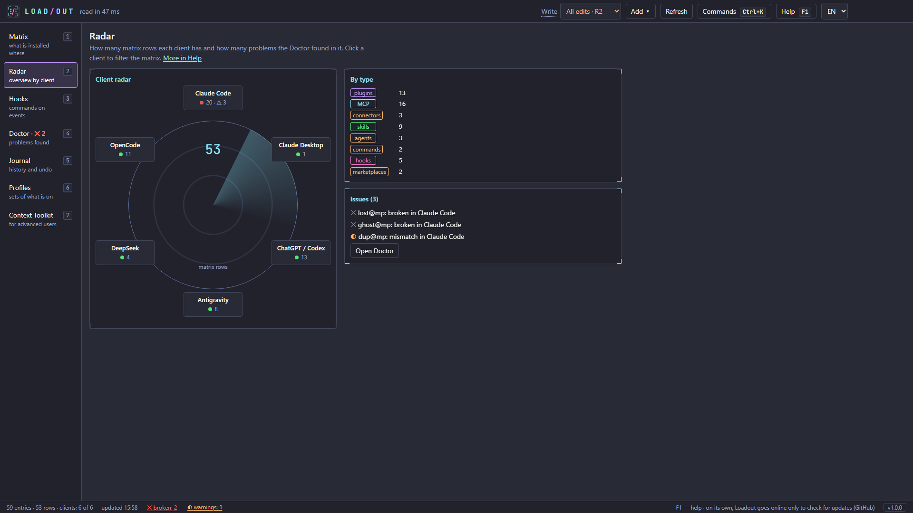
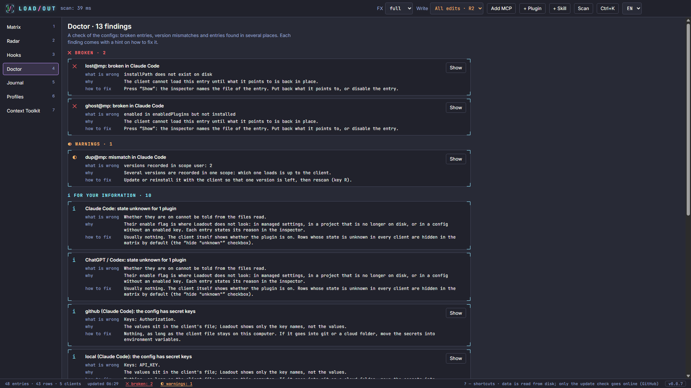
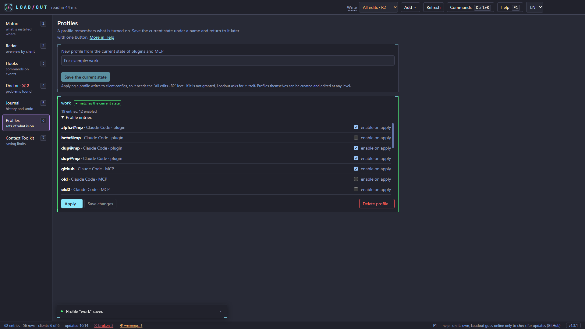
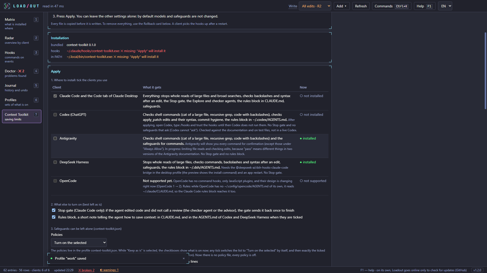
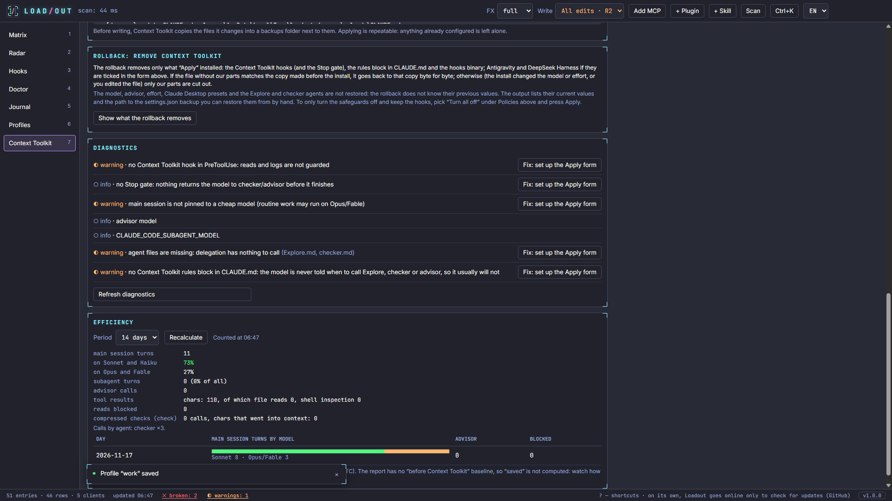

<div align="center">

# Loadout

**A Windows app that shows the plugins, MCP servers, skills and hooks of five AI coding clients in one matrix and edits their configs safely: preview, backup, journal, rollback.**

[English](README.md) · [Русский](README.ru.md)


[](https://github.com/d-ridelman/Loadout/releases/latest)


[](LICENSE)

</div>


*All screenshots are taken on the test data in `fixtures/`, not on a real profile.*

## Why

Claude Code, Claude Desktop, ChatGPT / Codex, Antigravity and DeepSeek Harness each keep plugins, MCP servers, skills, agents, hooks and commands in their own files and formats (JSON, TOML, YAML). Finding out what is enabled where, or moving a server from one client to another, means editing config files by hand.

Loadout reads all five clients, shows everything in one matrix and changes only the value you touched.

## Features

- **Matrix** of every entry across the five clients: enabled, disabled, broken, version mismatch. Filters by type and state, search, keyboard navigation, command palette (`Ctrl+K`). The inspector on the right shows the file, the key and the contents without secrets.
- **Radar, hooks, doctor.** A per-client overview, the hook pipeline by lifecycle event, and findings: broken entries, version mismatches, the same entry in several scopes, empty marketplaces, broken links to a cleaned cache, piles of third-party backups, MCP configs with secret keys.
- **Toggle** an entry (write level R1). **Move an MCP server to the Loadout trash, edit its command, copy it to another client** (R2); JSON, TOML and YAML are translated for you.
- **Add an MCP server** from the window. The `env` values you type go to the core and are not shown in the preview, the journal or the inspector.
- **Install a Claude Code plugin from a marketplace.** Add a marketplace by GitHub `owner/repo`, an `https://` or SSH address, or a local folder, then pick a plugin from its catalog. Before anything runs, the window shows the exact `claude plugin …` command.
- **Install a skill** into `~/.claude/skills` from a GitHub repository or a local folder. The window first says what will be downloaded and where, then shows a plan with the files and a warning when the skill contains code. The installation goes into the journal and can be rolled back.
- **Profiles**: capture the set of enabled plugins and MCP servers, apply it as one batch, roll the whole batch back.
- **Journal** of every write with one-click rollback. Before any write the file is copied to a backup.
- **Context Toolkit** built in: preview, apply, roll back, optional policies, and an "Efficiency" report (see below).
- **Russian and English UI**, switched in the header (RU / EN). The first launch follows the system language; core messages follow the choice too.
- **Read-only by default** (R0). Raising the write level needs an OS confirmation dialog. Only one window runs at a time; a second launch brings the first one forward.

### Safe write pipeline

plan → preview → hash lock (`base_sha`) → backup + manifest → temp file + rename → re-read and verify → journal / rollback. If a file changed after the preview, the write is refused. JSON is edited in place, TOML through `toml_edit`, YAML line by line: comments, key order and line endings stay. Details: [docs/CONCEPT.en.md](docs/CONCEPT.en.md) §5.

### Copies and secrets

Operation backups and the Loadout trash keep client configs **in full and as plain text, including the `env` values of MCP servers (keys and tokens)**. A masked copy could not give an exact rollback. They live in `%APPDATA%\loadout-app\backups` (the folder is named after the package, `loadout-app`), inside your Windows profile; Loadout sets no permissions of its own, so access is the same as for your other profile files. Nothing is sent anywhere. The dialog that enables writing (R1/R2) says so too.

- The last 100 operations not older than 90 days are kept. Older ones are deleted before a new write, by the "Clean up old copies…" button in the journal, and by `loadout prune` (default folder `%APPDATA%\loadout-app\backups`, another one with `--backups`). Rolling back an operation whose copy was deleted is refused with a clear message.
- The trash (`backups\trash`) is not cleaned automatically: it holds the only copy of a trashed MCP entry, which goes back into the client file when you turn the entry on. Profiles (`backups\profiles.json`) live in the same folder.
- Context Toolkit makes its own backups before it writes: `~/.claude/backups` for Claude Code, a `backups` folder next to the file for the other clients. These copies are also full files.

## Screenshots

| Radar | Hooks |
|---|---|
|  |  |

| Doctor | Journal and rollback |
|---|---|
|  |  |

| Add an MCP server | Install a plugin from a marketplace catalog |
|---|---|
|  |  |

| Install a skill | Profiles |
|---|---|
|  |  |

| Context Toolkit: form and policies | Context Toolkit: diagnostics and efficiency |
|---|---|
|  |  |

| Context Toolkit: rollback preview |  |
|---|---|
|  |  |

The screenshots are produced by `npm run docs-shots` in `app/` (window 1920×1080, fixtures only).

## Context Toolkit

[`crates/context-toolkit`](crates/context-toolkit/README.md) is a set of hooks and diagnostics that keeps agent context small: it limits whole-file reads, catches broken escaping, compresses build output and points agents to cheap search and independent review. It was called ctxkit before; the old name is still recognised, and `context-toolkit setup` moves an earlier installation to the new name.

In the app it is the **Context Toolkit** section (key `7`):

- **Preview** (`setup --dry-run`, writes nothing), **Apply** (needs R2 and a preview with the same settings) and **Roll back** (its own preview, removes only what Apply installed).
- Selects for the main model, effort and the advisor model. The default is "Keep as is": nothing is passed and nothing changes.
- Optional **policies** in `context-toolkit.json`, off until you turn them on: commit hygiene (blocks a commit with `Co-Authored-By` / `Generated with`), confirm irreversible commands (asks before `git push`, `reset --hard`, `rm -rf` and the like), stray report files, a parallel build limit.
- **Diagnostics** (`doctor`) and **Efficiency** (`report`): Claude Code turns by model, subagent and advisor calls, blocked reads, by day for 7, 14 or 30 days.

The app runs only the `context-toolkit.exe` shipped with it. Context Toolkit can also be installed on its own, see its README.

## Install

1. Download `Loadout.Setup.<version>.exe` from [Releases](https://github.com/d-ridelman/Loadout/releases/latest) and run it. It installs for the current user, by default into `%LOCALAPPDATA%\Programs\Loadout`; the folder can be changed.
2. **The installer is not signed.** Windows SmartScreen may show "Windows protected your PC": click "More info", then "Run anyway". The SHA-256 of the installer is in the release notes.
3. Silent install: `Loadout.Setup.<version>.exe /S`.

Installing plugins needs the `claude` CLI (Claude Code); installing skills from GitHub needs `git` in `PATH`.

**Uninstall** through Windows Settings → Apps, or silently: `& "$env:LOCALAPPDATA\Programs\Loadout\Uninstall Loadout.exe" /S`. The uninstaller leaves your data alone. To remove it, close Loadout and delete `%APPDATA%\loadout-app`. Deleting only `%APPDATA%\loadout-app\backups` removes the copies, the journal, the trash and the profiles. To trim old copies instead, run `& "$env:LOCALAPPDATA\Programs\Loadout\resources\loadout.exe" prune`.

## Build from source

Requirements: Windows 11 x64 (Windows 10 is not tested), Rust 1.89 or newer with the MSVC toolchain, Node.js 22.12 or newer, `git`.

```bash
git clone https://github.com/d-ridelman/Loadout.git
cd Loadout
cargo build --release          # core (loadout.exe) and context-toolkit.exe in target/release
cargo test                     # Rust tests
cd app
npm ci
npm run dev                    # the window in development mode
npm test                       # unit tests (vitest)
npm run e2e                    # builds everything and drives the real window on fixtures
npm run dist                   # NSIS installer in app/dist (unsigned)
```

`npm run e2e`, `npm run dist` and `npm run docs-shots` build the core and copy `context-toolkit.exe` into `app/build` themselves (`npm run bundle:context-toolkit`). More checks and the rules for changes: [CONTRIBUTING.md](CONTRIBUTING.md).

## Repository layout

| Path | What it is |
|---|---|
| `app/` | Desktop app (Electron + React + TypeScript) |
| `crates/loadout-core`, `crates/loadoutd` | Rust core: scan, write pipeline, file watcher; `loadout.exe` (CLI and the window's sidecar process) |
| `crates/context-toolkit` | Context Toolkit, in the same Cargo workspace |
| `docs/CONCEPT.en.md`, `docs/CONCEPT.md` | Design, decisions, milestone and audit notes (English, Russian) |
| `docs/screenshots/` | Screenshots for the READMEs (`npm run docs-shots`) |
| `fixtures/` | Synthetic client configs for tests and screenshots |
| `state/` | Window snapshots from the e2e scenarios |
| `mockup/` | The clickable mockup of the initial concept (historical) |

## Status

Version 0.0.7, Windows only. Milestones M0–M5 and the built-in Context Toolkit are done (see [docs/CONCEPT.en.md](docs/CONCEPT.en.md) §10).

Not done:

- code signing and auto-update (they need a code-signing certificate and a publishing address);
- macOS and Linux;
- project-level settings (`.claude/settings.json` in a project, `.mcp.json`): plugins enabled only there show as "unknown";
- the MCP check that starts a server and asks for its tools;
- a Claude Code profile other than `~/.claude` (`CLAUDE_CONFIG_DIR`) is not read.

## Security

How to report a vulnerability and what the app reads and writes: [SECURITY.md](SECURITY.md).

## License

[MIT](LICENSE). See also [CONTRIBUTING.md](CONTRIBUTING.md).
