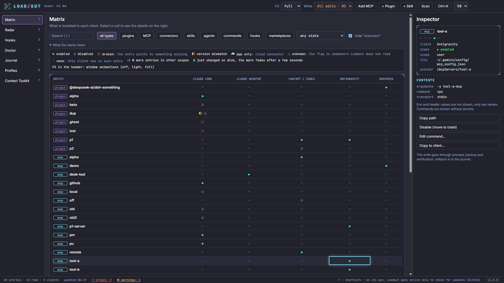
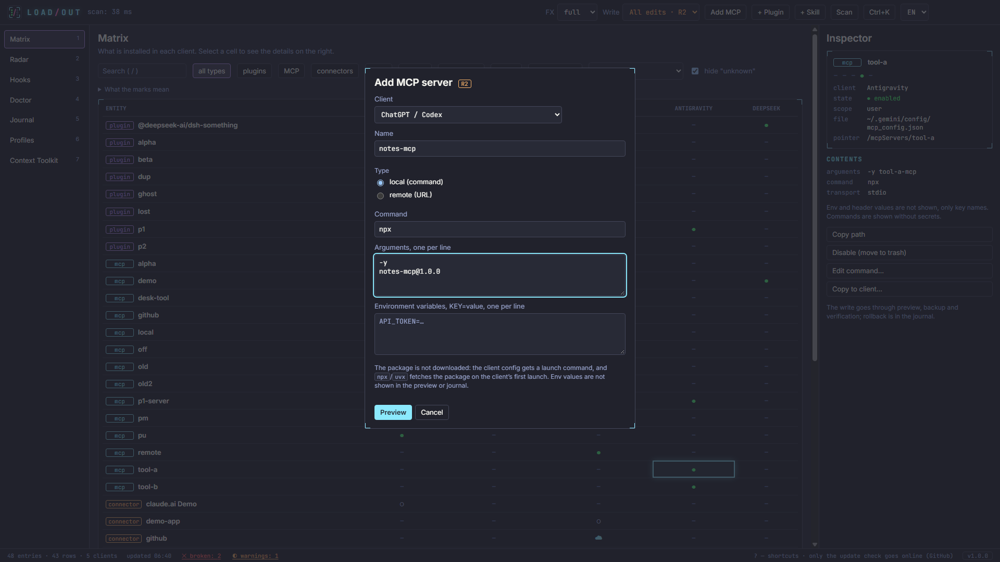
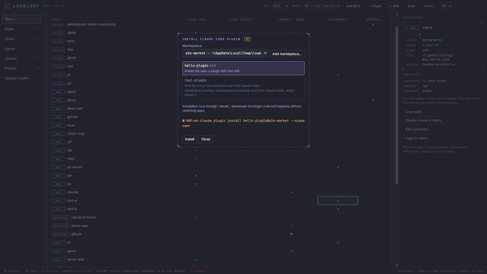
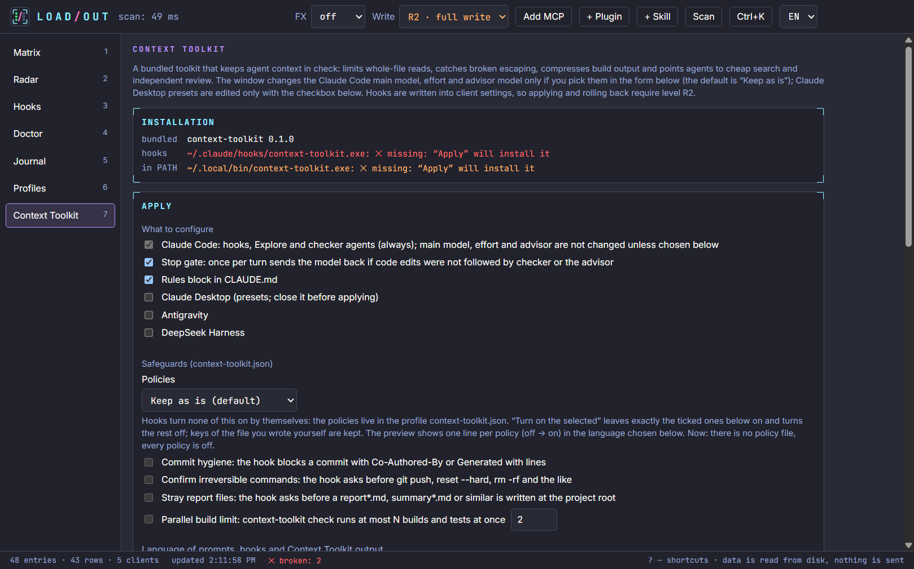

<div align="center">

# Loadout

**One screen for the plugins, MCP servers, skills and hooks of all your AI coding clients.**

[English](README.md) · [Русский](README.ru.md)


</div>



*Screenshots show test data from `fixtures/`, not a real profile.*

## Why

Claude Code, Claude Desktop, Codex, Antigravity and DeepSeek Harness each keep plugins, MCP servers, skills, agents, hooks and commands in their own files and formats (JSON, TOML, YAML). Finding out what is enabled where, or moving a server from one client to another, means editing config files by hand.

Loadout reads all five clients, shows everything in one matrix and changes it **surgically and safely**.

## Features

- **Matrix** of every entry across the five clients: enabled, disabled, broken, version drift. Plugins and MCP servers are separate groups. Inspector on the right.
- **Toggle** an entry (level R1). **Trash an MCP server, edit its command, copy it to another client** (level R2); JSON ⇄ TOML ⇄ YAML is translated for you.
- **Add an MCP server** and **install a Claude Code plugin** from the window. Environment values are never shown in the window, the preview or the journal.
- **Profiles**: snapshot a set of enabled entries, apply it as one batch, roll the whole batch back.
- **Journal** of every write with one-click rollback. Before any write the file is copied to a backup.
- **Doctor** finds broken links, drift, duplicates and stray backups.
- **ctxkit** built in: install, apply and see its effect (see below).
- **Russian and English UI**, switched in the header (RU / EN). The first launch follows the system language; messages of the core follow the choice too.
- Read-only by default (R0). Raising the write level needs an OS confirmation dialog.

### Safe write pipeline

plan → preview → hash lock (`base_sha`) → backup + manifest → temp file + rename → re-read and verify → journal / rollback. If a file changed after the preview, the write is refused. Details: [docs/CONCEPT.en.md](docs/CONCEPT.en.md) §5.

| Add an MCP server | Install a plugin |
|---|---|
|  |  |

| Journal and rollback | Doctor |
|---|---|
|  |  |

## ctxkit

[`crates/ctxkit`](crates/ctxkit/README.md) is a toolkit of hooks and diagnostics that keeps agent context small: it limits whole-file reads, catches broken escaping, compresses build output and points agents to cheap search and independent review (model, advisor and effort change only on explicit flags or an explicit choice in the form). It is built into the app (the **ctxkit** section) and can also be installed on its own.



## Repository layout

| Path | What it is |
|---|---|
| `app/` | Desktop app (Electron + React, Windows) |
| `crates/loadout-core`, `crates/loadoutd` | Rust core: scan, write pipeline, file watcher, sidecar process for the window |
| `crates/ctxkit` | ctxkit, built in the same Cargo workspace |
| `docs/CONCEPT.en.md`, `docs/CONCEPT.md` | Design, decisions, milestone and audit notes (English, Russian) |
| `docs/screenshots/` | Screenshots used in this README |
| `fixtures/`, `state/` | Test data and window snapshots produced by the e2e scenarios |

## Build and test

Requirements: Rust (MSVC toolchain), Node.js, Windows 10/11.

```bash
cargo build --release          # core and ctxkit (binaries in target/release)
cargo test                     # Rust tests
cd app && npm install
npm run e2e                    # build and drive the real window
npm run dist                   # installer (NSIS, unsigned)
```

`ctxkit.exe` for the app is built from `crates/ctxkit` (`npm run bundle:ctxkit`).

## Status

Pre-release. Milestones M0–M5 are done (see [docs/CONCEPT.en.md](docs/CONCEPT.en.md) §10). Code signing and auto-update are intentionally not done: they need a code-signing certificate and a publishing address, and the app works fully offline.

## License

[MIT](LICENSE). See also [CONTRIBUTING.md](CONTRIBUTING.md).
