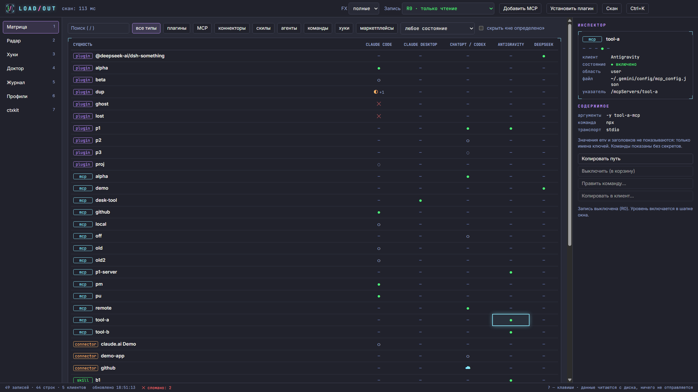

<div align="center">

# Loadout

**Один экран для плагинов, MCP-серверов, скилов и хуков всех ваших ИИ-клиентов для кода.**

[English](README.md) · [Русский](README.ru.md)


</div>



*Снимки сделаны на тестовых данных из `fixtures/`, не на настоящем профиле.*

## Зачем

Claude Code, Claude Desktop, Codex, Antigravity и DeepSeek Harness хранят плагины, MCP-серверы, скилы, агентов, хуки и команды каждый в своих файлах и форматах (JSON, TOML, YAML). Чтобы узнать, что где включено, или перенести сервер из одного клиента в другой, приходится править конфиги руками.

Loadout читает все пять клиентов, показывает всё в одной матрице и меняет **точечно и безопасно**.

## Возможности

- **Матрица** всех записей по пяти клиентам: включено, выключено, сломано, расхождение версий. Плагины и MCP в отдельных группах. Инспектор записи справа.
- **Включить и выключить** запись (уровень R1). **Вынести MCP в корзину, править команду, копировать в другой клиент** (уровень R2); формат JSON ⇄ TOML ⇄ YAML переводится сам.
- **Добавить MCP-сервер** прямо из окна. Значения env не показываются ни в окне, ни в предпросмотре, ни в журнале.
- **Установить плагин Claude Code из маркетплейса.** Маркетплейс добавляется по GitHub `owner/repo`, адресу `https://` или папке. Плагин выбирается из каталога маркетплейса с описаниями. Перед запуском `claude` окно показывает точную команду и что она запишет.
- **Установить скил** из GitHub-репозитория или папки в `~/.claude/skills`. Сначала окно говорит, что и куда будет скачано. Потом показывает план с файлами и предупреждением о коде. Установка пишется в журнал, и её можно откатить.
- **Профили**: снимок набора включённых записей, применение пакетом, откат пакета целиком.
- **Журнал** каждой записи с откатом в один клик. Перед любой записью файл копируется в бэкап.
- **Доктор** находит сломанные ссылки, расхождения, дубли и лишние копии конфигов.
- **ctxkit** встроен: установка, применение и эффективность (см. ниже).
- **Интерфейс на русском и английском**, переключатель в шапке (RU / EN). При первом запуске берётся язык системы; сообщения ядра тоже следуют выбору.
- По умолчанию окно только читает (R0). Повышение уровня записи подтверждается окном системы.

### Безопасная запись

план → предпросмотр → хеш-блокировка (`base_sha`) → бэкап и манифест → временный файл и rename → перечитать и сверить → журнал / откат. Если файл изменился после предпросмотра, запись отклоняется. Подробности: [docs/CONCEPT.md](docs/CONCEPT.md), §5.

### Копии и секреты

Бэкапы операций и корзина Loadout хранят конфиги клиентов **целиком и открытым текстом, включая значения `env` у MCP-серверов (ключи и токены)**. Они лежат в `%APPDATA%\loadout-app\backups` (папка данных приложения названа по пакету, `loadout-app`; внутри профиля Windows; отдельных прав Loadout не задаёт, доступ наследуется от профиля пользователя) и наружу не отправляются. Об этом сказано и в диалоге включения записи (R1/R2).

- Хранятся последние 100 операций и не старше 90 дней. Старое удаляется перед новой записью, по кнопке «Очистить старые копии» в журнале и командой `loadout prune` (по умолчанию в `%APPDATA%\loadout-app\backups`, другой каталог: `--backups`). Откат уже удалённой операции отклоняется с понятным текстом.
- Корзина (`backups\trash`) сама не чистится: там единственная копия вынесенной записи MCP, она вернётся в файл клиента при включении.
- Установщик при удалении приложения данные не трогает. Чтобы убрать всё, закройте Loadout и удалите папку `%APPDATA%\loadout-app` (или только `%APPDATA%\loadout-app\backups`). Команда очистки лежит рядом с приложением: `& "$env:LOCALAPPDATA\Programs\Loadout\resources\loadout.exe" prune`.

| Добавить MCP | Установить плагин |
|---|---|
|  |  |

| Журнал и откат | Доктор |
|---|---|
|  |  |

## ctxkit

[`crates/ctxkit`](crates/ctxkit/README.ru.md) — набор хуков и диагностики, который держит контекст агентов в рамках: ограничивает чтение целых файлов, ловит битые экранирования, сжимает вывод сборок, подсказывает агентам дешёвый поиск и независимую проверку (модель, советник и effort меняются только по явным флагам или явному выбору в форме). Встроен в приложение (раздел «ctxkit»), но ставится и отдельно.


## Устройство репозитория

| Путь | Что это |
|---|---|
| `app/` | Приложение (Electron + React, Windows) |
| `crates/loadout-core`, `crates/loadoutd` | Ядро на Rust: скан, конвейер записи, сторож файлов, процесс-ядро для окна |
| `crates/ctxkit` | ctxkit, собирается в том же Cargo-воркспейсе |
| `docs/CONCEPT.md`, `docs/CONCEPT.en.md` | Концепция, решения, итоги этапов и аудитов (русский, английский) |
| `docs/screenshots/` | Снимки для этого README |
| `fixtures/`, `state/` | Тестовые данные и снимки окна из сценариев e2e |

## Сборка и проверки

Нужны: Rust (набор MSVC), Node.js, Windows 10/11.

```bash
cargo build --release          # ядро и ctxkit (бинари в target/release)
cargo test                     # тесты Rust
cd app && npm install
npm run e2e                    # сборка и сценарии в настоящем окне
npm run dist                   # установщик (NSIS, без подписи)
```

`ctxkit.exe` для приложения собирается из `crates/ctxkit` (`npm run bundle:ctxkit`).

## Статус

Пред-релиз. Этапы M0–M5 сделаны (см. [docs/CONCEPT.md](docs/CONCEPT.md), §10). Подпись кода и автообновление сознательно не сделаны: нужны сертификат подписи и адрес публикации, а приложение целиком работает без сети.

## Лицензия

[MIT](LICENSE). См. также [CONTRIBUTING.ru.md](CONTRIBUTING.ru.md).
