<div align="center">

# Loadout

**Программа для Windows: плагины, MCP-серверы, скилы и хуки пяти ИИ-клиентов для кода в одной матрице и безопасная правка их конфигов: предпросмотр, бэкап, журнал, откат.**

[English](README.md) · [Русский](README.ru.md)


[](https://github.com/d-ridelman/Loadout/releases/latest)


[](LICENSE)

</div>

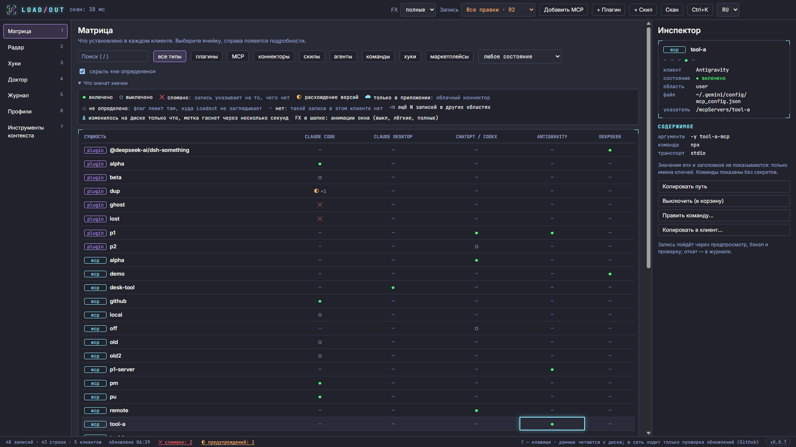

*Все снимки сделаны на тестовых данных из `fixtures/`, не на настоящем профиле.*

## Зачем

Claude Code, Claude Desktop, ChatGPT / Codex, Antigravity и DeepSeek Harness хранят плагины, MCP-серверы, скилы, агентов, хуки и команды каждый в своих файлах и форматах (JSON, TOML, YAML). Чтобы узнать, что где включено, или перенести сервер из одного клиента в другой, приходится править конфиги руками.

Loadout читает все пять клиентов, показывает всё в одной матрице и меняет только то значение, которое вы тронули.

## Возможности

- **Матрица** всех записей по пяти клиентам: включено, выключено, сломано, расхождение версий. Фильтры по типу и состоянию, поиск, управление с клавиатуры, палитра команд (`Ctrl+K`). Инспектор справа показывает файл, ключ и содержимое без секретов.
- **Радар, хуки, доктор.** Сводка по клиентам, конвейер хуков по событиям жизненного цикла и находки: сломанные записи, расхождения версий, одна запись в нескольких областях, пустые маркетплейсы, битые ссылки на очищенный кеш, залежи чужих бэкапов, MCP с ключами секретов в конфиге.
- **Включить и выключить** запись (уровень записи R1). **Вынести MCP в корзину Loadout, править команду, копировать в другой клиент** (R2); JSON, TOML и YAML переводятся сами.
- **Добавить MCP-сервер** из окна. Введённые значения `env` уходят в ядро и не показываются ни в предпросмотре, ни в журнале, ни в инспекторе.
- **Установить плагин Claude Code из маркетплейса.** Маркетплейс добавляется по GitHub `owner/repo`, адресу `https://` или SSH либо по локальной папке, плагин выбирается из его каталога. До запуска окно показывает точную команду `claude plugin …`.
- **Установить скил** в `~/.claude/skills` из GitHub-репозитория или локальной папки. Сначала окно говорит, что и куда будет скачано, потом показывает план с файлами и предупреждение, если в скиле есть код. Установка пишется в журнал, её можно откатить.
- **Профили**: снимок набора включённых плагинов и MCP, применение пакетом, откат пакета целиком.
- **Журнал** каждой записи с откатом в один клик. Перед любой записью файл копируется в бэкап.
- **Инструменты контекста** встроены: предпросмотр, применение, откат, политики по желанию и отчёт «Эффективность» (см. ниже).
- **Интерфейс на русском и английском**, переключатель в шапке (RU / EN). При первом запуске берётся язык системы; сообщения ядра тоже следуют выбору.
- **Файлы клиентов по умолчанию только читаются** (R0). Повышение уровня записи подтверждается окном системы. Окно запускается в одном экземпляре: второй запуск выводит вперёд первое.

### Безопасная запись

план → предпросмотр → хеш-блокировка (`base_sha`) → бэкап и манифест → временный файл и rename → перечитать и сверить → журнал / откат. Если файл изменился после предпросмотра, запись отклоняется. JSON правится на месте, TOML через `toml_edit`, YAML по строкам: комментарии, порядок ключей и переводы строк сохраняются. Подробности: [docs/CONCEPT.md](docs/CONCEPT.md), §5.

### Копии и секреты

Бэкапы операций и корзина Loadout хранят конфиги клиентов **целиком и открытым текстом, включая значения `env` у MCP-серверов (ключи и токены)**: из скрытой копии точный откат не сделать. Они лежат в `%APPDATA%\loadout-app\backups` (папка названа по пакету, `loadout-app`) внутри вашего профиля Windows; отдельных прав Loadout не задаёт, доступ такой же, как к остальным файлам профиля. Наружу ничего не отправляется. Об этом сказано и в диалоге включения записи (R1/R2).

- Хранятся последние 100 операций не старше 90 дней. Старые удаляются перед новой записью, кнопкой «Очистить старые копии…» в журнале и командой `loadout prune` (по умолчанию папка `%APPDATA%\loadout-app\backups`, другую задаёт `--backups`). Откат операции, чья копия уже удалена, отклоняется с понятным текстом.
- Корзина (`backups\trash`) сама не чистится: там единственная копия вынесенной записи MCP, она вернётся в файл клиента при включении. Профили (`backups\profiles.json`) лежат в той же папке.
- Инструменты контекста перед записью делают свои бэкапы: `~/.claude/backups` для Claude Code, рядом с изменяемым файлом для остальных клиентов (обычно в подпапке `backups`). Это тоже файлы целиком.

## Снимки

| Радар | Хуки |
|---|---|
| 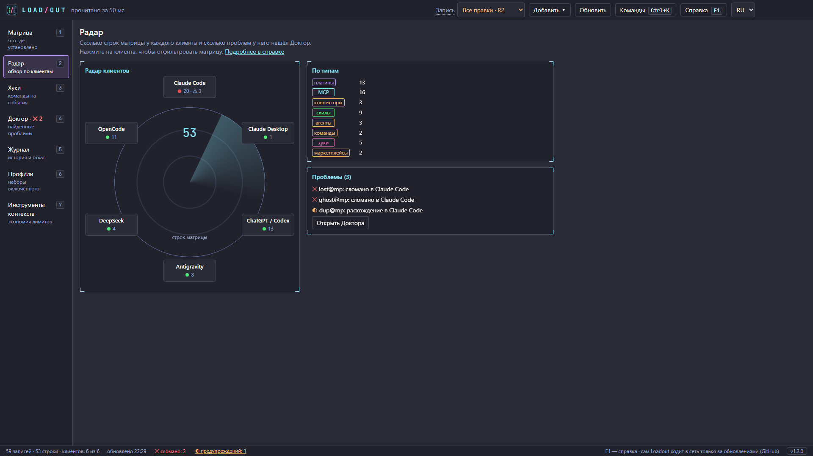 | 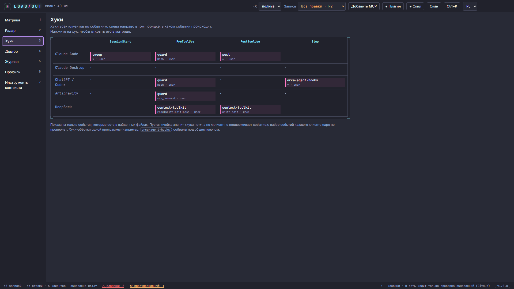 |

| Доктор | Журнал и откат |
|---|---|
| 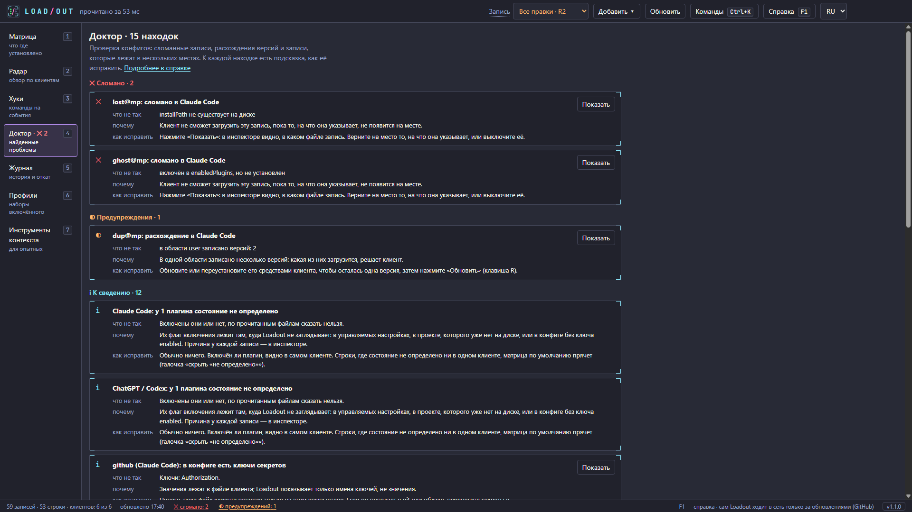 | 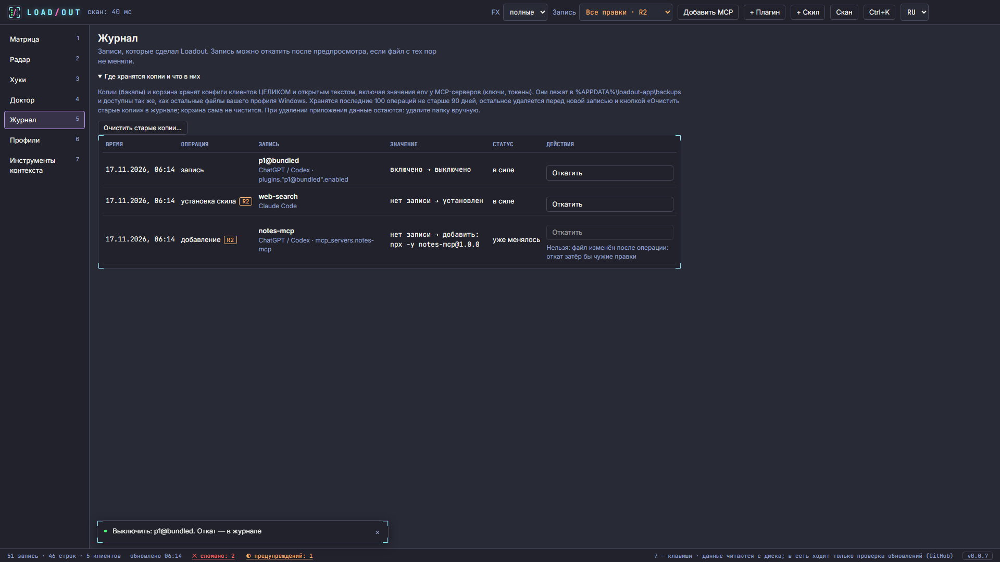 |

| Добавить MCP-сервер | Установить плагин из каталога маркетплейса |
|---|---|
| 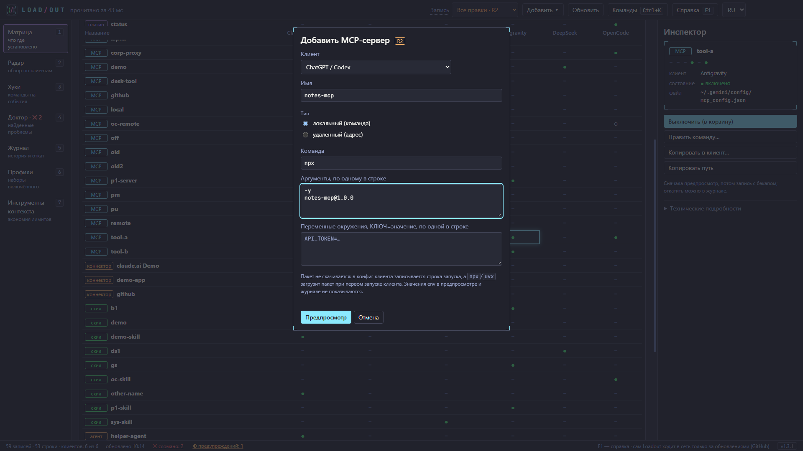 | 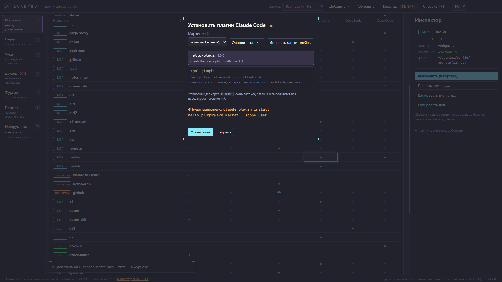 |

| Установить скил | Профили |
|---|---|
| 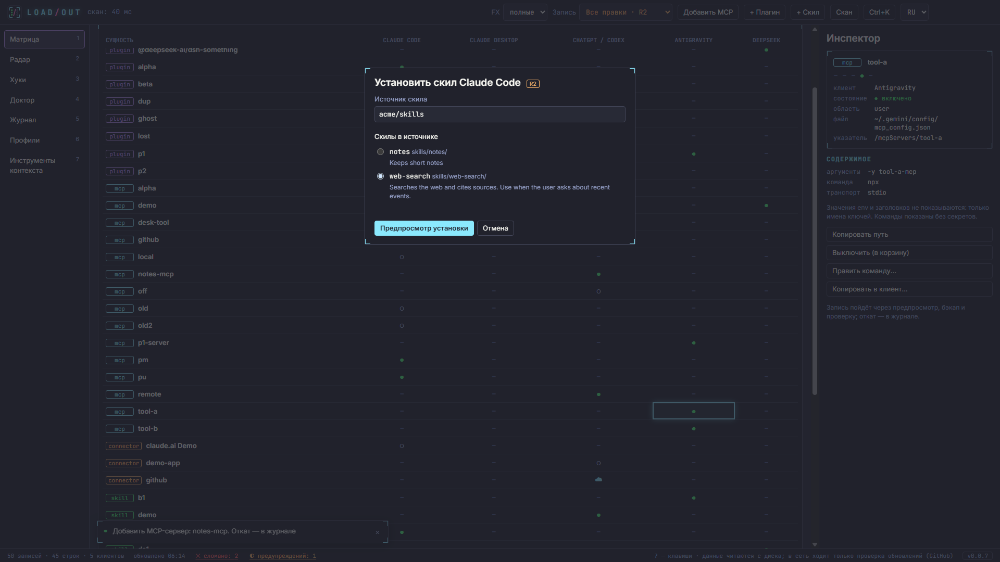 | 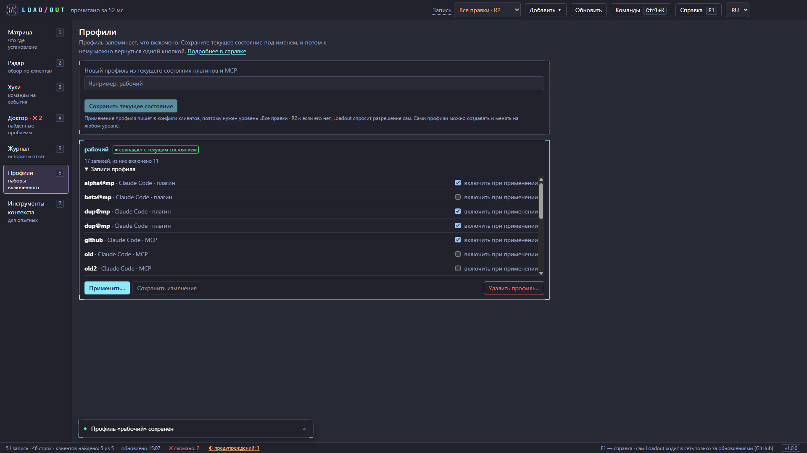 |

| Инструменты контекста: форма и политики | Инструменты контекста: диагностика и эффективность |
|---|---|
| 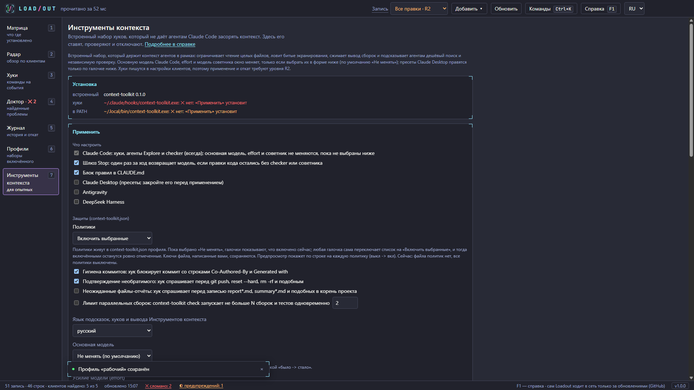 | 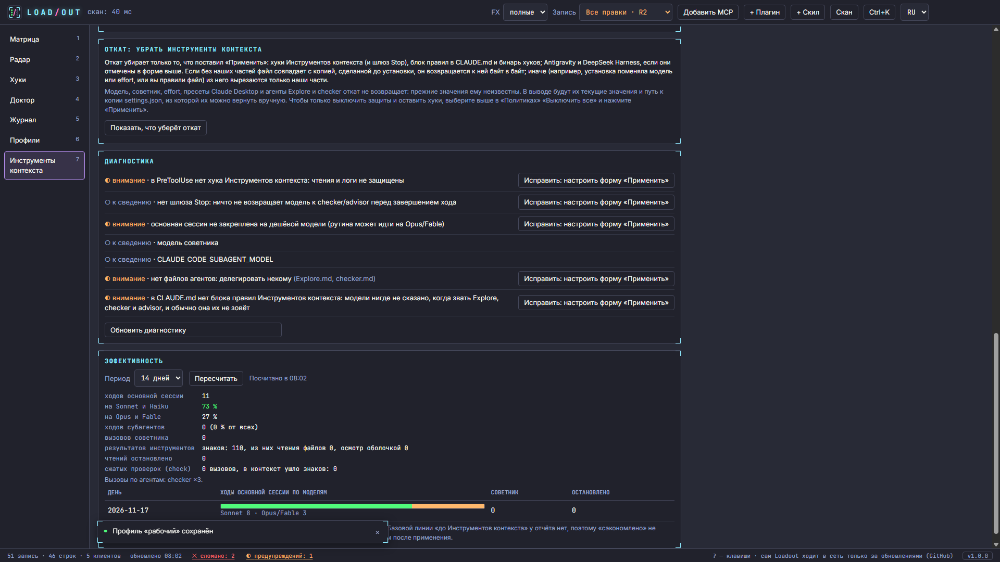 |

| Инструменты контекста: предпросмотр отката |  |
|---|---|
| 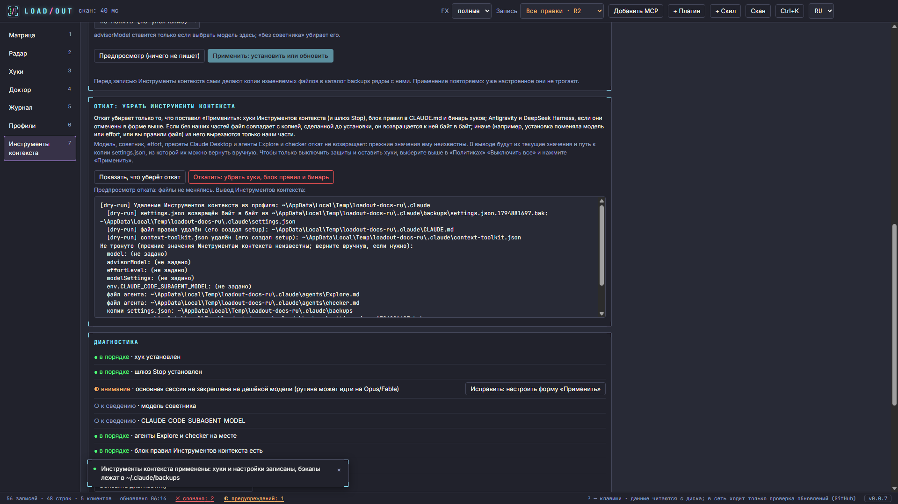 |  |

Снимки делает `npm run docs-shots` в `app/` (окно 1920×1080, только фикстуры).

## Инструменты контекста

[`crates/context-toolkit`](crates/context-toolkit/README.ru.md) (Context Toolkit) это набор хуков и диагностики, который держит контекст агентов в рамках: ограничивает чтение целых файлов, ловит битые экранирования, сжимает вывод сборок, подсказывает агентам дешёвый поиск и независимую проверку. Раньше он назывался ctxkit; старое имя по-прежнему распознаётся, а `context-toolkit setup` переводит прежнюю установку на новое.

В приложении это раздел **«Инструменты контекста»** (клавиша `7`):

- **Предпросмотр** (`setup --dry-run`, ничего не пишет), **применение** (нужны R2 и предпросмотр с теми же настройками) и **откат** (со своим предпросмотром, убирает только то, что поставило применение).
- Селекты основной модели, effort и модели-советника. По умолчанию «Не менять»: флаг не передаётся, ничего не меняется.
- **Политики** в `context-toolkit.json` по желанию, выключены, пока вы их не включите: гигиена коммитов (блокирует коммит с `Co-Authored-By` / `Generated with`), подтверждение необратимого (спрашивает перед `git push`, `reset --hard`, `rm -rf` и подобным), неожиданные файлы-отчёты, лимит параллельных сборок.
- **Диагностика** (`doctor`) и **«Эффективность»** (`report`): ходы Claude Code по моделям, вызовы субагентов и советника, остановленные чтения, по дням за 7, 14 или 30 дней.

Окно запускает только свой `context-toolkit.exe` из комплекта, никогда не из `PATH`. Инструменты контекста можно поставить и отдельно, см. их README.

## Установка

1. Скачайте `Loadout.Setup.<версия>.exe` со страницы [Releases](https://github.com/d-ridelman/Loadout/releases/latest) и запустите. По умолчанию установка идёт для текущего пользователя в `%LOCALAPPDATA%\Programs\Loadout`; установщик предлагает и установку для всех пользователей, и другую папку (пути ниже даны для варианта по умолчанию).
2. **Установщик не подписан.** Windows SmartScreen может предупредить о неизвестном приложении; раскройте подробности в его окне и выберите запуск установщика несмотря на предупреждение. SHA-256 установщика есть в описании релиза.
3. Тихая установка: `Loadout.Setup.<версия>.exe /S`.

Для установки плагинов нужен CLI `claude` (Claude Code), для установки скилов из GitHub нужен `git` в `PATH`.

**Удаление**: через «Параметры Windows» → «Приложения» или тихо: `& "$env:LOCALAPPDATA\Programs\Loadout\Uninstall Loadout.exe" /S`. Данные при этом остаются. Чтобы убрать и их, закройте Loadout и удалите `%APPDATA%\loadout-app`. Если удалить только `%APPDATA%\loadout-app\backups`, пропадут копии, журнал, корзина и профили. Чтобы лишь подрезать старые копии, выполните `& "$env:LOCALAPPDATA\Programs\Loadout\resources\loadout.exe" prune`.

## Сборка из исходников

Нужны: Windows 11 x64 (Windows 10 не проверялась), Rust 1.91 или новее с набором MSVC (нижняя граница от `notify-types` в `Cargo.lock`), Node.js 22.12+, 24 или 26+ (23 и 25 vitest не поддерживает), `git`.

```bash
git clone https://github.com/d-ridelman/Loadout.git
cd Loadout
cargo build --release          # ядро (loadout.exe) и context-toolkit.exe в target/release
cargo test                     # тесты Rust
cd app
npm ci
npm run dev                    # окно в режиме разработки
npm test                       # модульные тесты (vitest)
npm run e2e                    # собирает всё и гоняет настоящее окно на фикстурах
npm run dist                   # установщик NSIS в app/dist (без подписи)
```

`npm run e2e`, `npm run dist` и `npm run docs-shots` сами собирают ядро и кладут `context-toolkit.exe` в `app/build` (`npm run bundle:context-toolkit`). Остальные проверки и правила правок: [CONTRIBUTING.ru.md](CONTRIBUTING.ru.md).

## Устройство репозитория

| Путь | Что это |
|---|---|
| `app/` | Приложение (Electron + React + TypeScript) |
| `crates/loadout-core`, `crates/loadoutd` | Ядро на Rust: скан, конвейер записи, сторож файлов; `loadout.exe` (CLI и процесс-ядро для окна) |
| `crates/context-toolkit` | Инструменты контекста, в том же Cargo-воркспейсе |
| `docs/CONCEPT.md`, `docs/CONCEPT.en.md` | Концепция, решения, итоги этапов и аудитов (русский, английский) |
| `docs/screenshots/` | Снимки для README (`npm run docs-shots`) |
| `fixtures/` | Синтетические конфиги клиентов для тестов и снимков |
| `state/` | Снимки окна из сценариев e2e |
| `mockup/` | Кликабельный макет начального замысла (исторический) |

## Статус

Версия 0.0.7, только Windows. Этапы M0–M5 и встроенные Инструменты контекста сделаны (см. [docs/CONCEPT.md](docs/CONCEPT.md), §10).

Известные ограничения:

- подпись кода и автообновление (нужны сертификат подписи и адрес публикации);
- macOS и Linux;
- настройки уровня проекта (`.claude/settings.json` в проекте, `.mcp.json`): плагины, включённые только там, показываются как «не определено»;
- проверка MCP запуском сервера и запросом списка его инструментов;
- профиль Claude Code не из `~/.claude` (`CLAUDE_CONFIG_DIR`) не читается.

Открытая работа записана в [TODO.md](TODO.md): один пункт со сроком, сравнить вызовы advisor и `checker` по дням после 22.11.2026.

## Безопасность

Как сообщить об уязвимости и что приложение читает и пишет: [SECURITY.ru.md](SECURITY.ru.md).

## Лицензия

[MIT](LICENSE). См. также [CONTRIBUTING.ru.md](CONTRIBUTING.ru.md).
