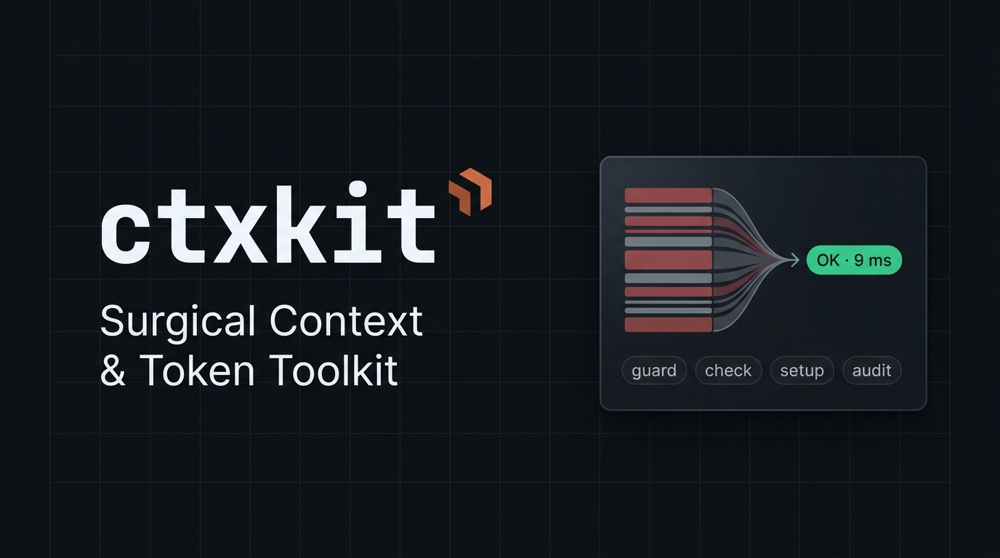

# Context Toolkit

> Formerly called ctxkit. The old name is still recognised, and `context-toolkit setup` moves an existing installation to the new name (see [Moving from ctxkit](#moving-from-ctxkit)).

<p align="center">
  
</p>

<p align="center">
  <strong>English</strong> | <a href="README.ru.md">Русский</a>
</p>

<p align="center">
  <a href="#quick-start">Quick Start</a> ·
  <a href="#whats-inside">Modules</a> ·
  <a href="#setup-flags">Setup Flags</a> ·
  <a href="docs/ARCHITECTURE.md">Architecture</a> ·
  <a href="docs/RESEARCH.md">Research (30 Sessions)</a>
</p>

Context Toolkit is a single native Rust binary (`context-toolkit`) for **Claude Code**, **Claude Desktop**, **Antigravity**, and **DeepSeek Harness Desktop**. It stops agents from dumping whole files and raw compiler logs into context, blocks shell commands that mangle backslashes, and configures a low-waste model setup with one command.

Rust is only the runtime choice for fast startup (`9-14 ms` per hook call without spawning Node or Python). The toolkit targets **any project stack** (TypeScript/JS, Python, Go, Rust, config repositories): in an audit of 30 sessions, `60.5%` of incoming bloat came from reading large source files whole and running unfiltered grep in the shell.

## Where Limits Go

Findings from 30 recorded sessions (`26,256` turns; full breakdown in [the research note](docs/RESEARCH.md)):

| Baseline leak | How Context Toolkit addresses it |
|---|---|
| `95.3%` of turns ran on `Opus` or `Fable` (including Desktop presets and search) | `context-toolkit setup --main-model sonnet --advisor fable` moves routine work to `Sonnet` and keeps `Fable` for escalations; setup also adds search on `Haiku` (`Explore`) and `Opus` for `checker` |
| `60.5%` of `tool_result` chars came from full-file reads and unfiltered `rg`/`cat` | `PreToolUse` hook permits bounded slices (`<= 450` lines) and steers full reads to `Grep`, LSP, or `Explore` |
| `11.2%` came from verbose compiler and test runner logs | `context-toolkit check <cmd>` collapses passing runs to `OK (<ms>)` and extracts root causes on failure |
| Mangled `\` escapes in inline one-liners triggered extra rewrite loops | Blocks backslash-bearing `node -e`, `python -c`, heredocs, and here-strings before execution; validates edited files on `PostToolUse` |

## Quick Start

**Requirements:** [Rust / Cargo](https://rustup.rs/) to build from source, [Node.js](https://nodejs.org/) to run `tests/guard.test.mjs`, `scripts/audit-sessions.mjs`, and `.js` `PostToolUse` syntax checks, and Python 3 (optional, for `.py` syntax checks).

### Windows (PowerShell)

```powershell
git clone https://github.com/d-ridelman/Loadout.git
cd Loadout/crates/context-toolkit
.\scripts\install.ps1            # -DryRun: only print; builds, copies and changes nothing

# The script adds %USERPROFILE%\.local\bin to the User PATH without expanding the other entries
# (%USERPROFILE%\go\bin stays as it is; the value is written as REG_EXPAND_SZ).
# Open a new terminal so User PATH picks up the folder, or call it directly:
& "$env:USERPROFILE\.local\bin\context-toolkit.exe" setup --dry-run
& "$env:USERPROFILE\.local\bin\context-toolkit.exe" setup --with-rules --desktop --antigravity
```

### macOS and Linux

```bash
git clone https://github.com/d-ridelman/Loadout.git
cd Loadout/crates/context-toolkit
./scripts/install.sh

~/.local/bin/context-toolkit setup --dry-run
~/.local/bin/context-toolkit setup --with-rules
```

Before changing `settings.json`, `CLAUDE.md`, `ccd-session-presets.json`, or `hooks.json`, `context-toolkit setup` creates a timestamped backup under `backups/`. Custom `env`, permissions, enabled plugins, and third-party hooks are preserved, while legacy `ctxkit`, `claude-guard` and `no-inline-backslash` hook entries are upgraded in place (see [Moving from ctxkit](#moving-from-ctxkit)).

Every file `setup` rewrites is written atomically: the new content goes to a temporary file beside the target and is renamed over it, so a crash or a full disk leaves the old file whole. A symbolic link is written through (it stays a link) and the permissions of the old file carry over. Known limit: `serde_json` keeps object keys sorted, so a JSON file that `setup` rewrites (`settings.json`, `hooks.json`, the presets file) comes back with its keys in alphabetical order and standard indentation; the values are unchanged. Keeping the order would need the `preserve_order` feature of `serde_json`, which is one switch for the whole Cargo workspace and would also change what `loadout-core` writes when it copies values (the build of the whole workspace and `cargo test -p loadout-core` would produce different output), so it stays off.

Before it copies the binary or writes anything, `setup` reads every file it is going to change and refuses on one it cannot handle (a `settings.json` of an odd shape, a `CLAUDE.md` / `AGENTS.md` with `--with-rules` that is not UTF-8 or has a doubled or unpaired Context Toolkit marker (an older setup could leave that; `doctor` warns about it as `rules_markers`, naming the file), a broken Desktop presets file or Antigravity `hooks.json`, a DeepSeek Harness `cordis.patch.yml` with a half block or a top level that is not a list, a broken `context-toolkit-hooks.json`). A refusal exits `1` and leaves no copied binary, no rewritten file and no backup behind.

## What's Inside

```text
  PreToolUse / PostToolUse              CLI
  ────────────────────────              ───
  Claude Code, Antigravity, DSH         context-toolkit setup   ──▶  models, agents, hooks, diagnostics
        │                               context-toolkit check   ──▶  compact tsc / pytest / go test / cargo
        ├──▶ guard.rs      (< 15 ms, blocks full reads > 28 KB / > 450 lines and broad grep)
        └──▶ backslash.rs  (catches stripped \ pre-tool; checks .json/.js/.py syntax post-tool)
```

| Module | Role | Behavior |
|---|---|---|
| `guard.rs` | Read and search guard | Blocks whole-file reads above `28 KB` / `450` lines (and `> 250 KB` without range) in `Read`, `read_file`, and DSH `read`, while skipping images, audio, video, and PDFs. A tail read from an offset passes only when the rest fits both caps. Blocks bare `cat`, `Get-Content`, and unfiltered recursive `grep -r`/`rg` (a search in one named file is fine) without touching pipes or `&&` chains. |
| `backslash.rs` | Escape and syntax guard | On `PreToolUse`, blocks backslash-heavy inline code (`node -e`, `python -c`, `perl -e`, `php -r`, `bash -c`), `sed -i`, heredocs, PowerShell here-strings, and throwaway patch scripts; syntax-check flags such as `node -c` are left alone. On `PostToolUse`, validates `.json` (skipping `tsconfig`, `.vscode/`, and `.devcontainer/`; any other file that is not strict JSON is parsed again as JSONC, so `turbo.json` or `biome.json` with comments and trailing commas pass, and only a file that fails both ways is blocked), `.js/.mjs/.cjs` (`node --check`), and `.py` (`ast.parse`). |
| `check.rs` | Output compressor (`context-toolkit check`) | For `cargo check`/`clippy`/`build`, enables `--message-format=json` and prints up to 3 deduplicated `file:line:col` root causes. For `tsc`, `npm test`, `node --test`, `pytest`, or `go test`, prints `OK (<ms>)` on pass, or up to 30 key lines on failure with the full log saved to `%TEMP%/last-check-<pid>.log` (`/tmp/...` on Unix; the path is printed, logs older than a day are deleted on the next write). On Windows the command is started directly (`npm` is found as `npm.cmd` through `PATH` / `PATHEXT`), so `&`, `\|`, `%`, `^` in its arguments arrive unchanged; only a name that is no file (a `cmd` built-in such as `dir`) goes through `cmd.exe /d /c`. |
| `policy.rs`, `shell.rs`, `commit.rs`, `irreversible.rs`, `stray.rs`, `slots.rs`, `dupes.rs` | Policies (see "Policies") | `policy.rs` reads `<profile>/context-toolkit.json`; `shell.rs` is the Bash / PowerShell lexer the command policies share (quotes, `$(...)`, heredocs, here-strings); `commit.rs`, `irreversible.rs` and `stray.rs` are the hook rules, `slots.rs` is the slot lock of `context-toolkit check`, `dupes.rs` is the duplicate-rule search of `doctor`. All off until `setup --policy` turns them on. |
| `setup.rs` | Environment setup (`context-toolkit setup`) | Wires the hooks, creates `Explore.md` (`haiku`) and `checker.md` (`opus`), adds the rules block with `--with-rules`, and audits CLI version, Claude plugins/`CLAUDE.md`/MCPs, and Antigravity MCPs/plugins/`agy` CLI model. Model, advisor and effort are set **only by flags**: `--main-model`, `--advisor`, `--effort` (the former scheme: `context-toolkit setup --main-model sonnet --advisor fable --effort high`); `CLAUDE_CODE_SUBAGENT_MODEL` only with `--subagent`. Every run prints "was -> became" (or "kept") per setting, also with `--dry-run`. |

## Setup Flags

`setup` does not change your model choices on its own: `model`, `advisorModel` and the effort are written only when you pass the flag, otherwise they stay as they are (a key that is absent stays absent) and the output says `model: opus (kept; pass --main-model sonnet to set)`. For the workflow Context Toolkit was tuned for (`fable` advisor + `claude-sonnet-5-5` main model) run `context-toolkit setup --main-model sonnet --advisor fable --effort high`. The Loadout window passes `--advisor` only when an advisor is picked in its form (the default is "keep as is") and never passes `--main-model` or `--effort`.

| Flag | Purpose |
|---|---|
| `--dry-run` | Print planned edits and diagnostics without modifying files |
| `--profile <dir>` | Target a secondary profile directory (such as `~/.claude-work`) |
| `--main-model <name>` | Write `model` (for example `sonnet`) |
| `--advisor <name>` | Write `advisorModel` (`fable`, `opus`, or `none` to remove it) |
| `--effort <level>` | Write the effort: `modelSettings.<model>.effortLevel` for `--main-model` or your own `model` (known model, `low`/`medium`/`high`/`xhigh`), the top-level `effortLevel`, and the effort of Desktop presets with `--desktop` |
| `--desktop` | Set the `modelId` (`--desktop-model`) of Claude Desktop presets (`ccd-session-presets.json`); the effort of a preset changes only with `--effort`. Run it with Claude Desktop fully quit (tray icon too): the running app keeps presets in memory and saves them over the file, so setup skips the write and warns while it runs |
| `--desktop-model <id>` | Desktop preset `modelId` override (default: `claude-sonnet-5-5`) |
| `--antigravity` | Register `context-toolkit --agy` in `~/.gemini/config/hooks.json` (a custom `--hook-cmd` gets ` --agy` appended) and audit Antigravity MCPs, plugins, and CLI model |
| `--dsh` | Write `~/.dsh/context-toolkit-hooks.json` and mount the `@deepseek-ai/dsh-hooks-claude-code` bridge on it in the DeepSeek Harness `desktop` profile (`--dsh-home <path>` overrides `~/.dsh`); warns with the exact `pnpm add` command when the bridge package is missing |
| `--with-rules` | Insert or update the compact rule block in `CLAUDE.md` between `context-toolkit` markers (a block between the old `ctxkit` or `claude-guard` markers is moved to the new ones). The block is generated from one source: besides the model-team lines it gets one short line per policy that is on in `context-toolkit.json`, then the `rules` items you wrote there, as they are (not translated); turn a policy off and rerun to drop its line. Rerunning changes nothing when nothing changed |
| `--force-agents` | Overwrite existing `Explore.md` and `checker.md` |
| `--no-stop-gate` | Do not wire the Stop gate and remove ours if present. By default `setup` adds a `Stop` hook: when a turn edited two or more code files (or made five or more edits) and neither `checker` nor the advisor ran after the last edit, the model is sent back once. Never twice in a row; `CONTEXT_TOOLKIT_GATE=0` mutes it per session. The message names only what exists: `checker` (`agents/checker.md` in the profile or the project) and/or the advisor (`advisorModel` in `settings.json`); with neither (for example `--advisor none --no-agents`) the gate stays silent |
| `--policy <list>` | Which policies of `context-toolkit.json` are on (`commit-hygiene`, `confirm-irreversible`, `stray-files`, `build-slots=N`; `none` turns all off). Not changed without the flag; see "Policies" |
| `--lang <en\|ru>` | Language for prompts, rules, hooks **and everything `setup` / `setup --uninstall` print** (`en` default; `ru` sets `CONTEXT_TOOLKIT_LANG=ru` in `settings.json` and adds `--lang ru` in `hooks.json`). Markup that tools parse is the same in both languages: `[dry-run]`, `[warn]`, `[note]`, `[ok]`, `[info]`, `ERR:`, the ` -> ` of "was -> became", flags, paths and model names |

Hooks read `CONTEXT_TOOLKIT_LANG` (`en` default, `ru` for Russian messages; the old name `CTXKIT_LANG` is still supported, the new one wins when both are set) or `--lang en|ru`. Run `context-toolkit setup --help` for the complete option list. Manual config templates sit in [`examples/`](examples/) using POSIX placeholder paths; run `context-toolkit setup` to resolve OS-specific absolute paths automatically.

## How to roll back

```powershell
context-toolkit setup --uninstall --dry-run     # what would be removed
context-toolkit setup --uninstall               # remove it (add the same --profile / --antigravity / --dsh you used for setup)
```

`--uninstall` removes only what setup added, under the new name and the old one (ctxkit): our elements in the `PreToolUse` / `PostToolUse` / `Stop` hooks of `settings.json` (a hook is ours when its command runs a file named `context-toolkit`, `ctxkit`, `claude-guard` or `no-inline-backslash`: the first word, or the second one after `node`/`bun`/`deno`/`npx`/`python`; so `node C:/x/no-inline-backslash.mjs` is ours while `node C:/tools/ctxkit-helper/stop.js` and `logger.exe ctxkit` are not; other people's hooks in the same group stay; a hook you wrote yourself that calls `context-toolkit` or `ctxkit`, such as `context-toolkit report` in a Stop hook, is also treated as ours, so keep such commands in a script with another name), both `env.CONTEXT_TOOLKIT_LANG` and `env.CTXKIT_LANG`, the rules block in `CLAUDE.md` between any of the three kinds of markers (`context-toolkit`, `ctxkit`, `claude-guard`), the `policies` section in both `context-toolkit.json` and `ctxkit.json` (see "Policies"), and our binaries `hooks/context-toolkit` and `hooks/ctxkit` (last, so no hook is left pointing at a missing file). With `--antigravity` / `--agy-file` it removes our entry from `hooks.json` under any of its names (`context-toolkit`, `ctxkit`, `claude-guard`); with `--dsh` / `--dsh-home` it removes both `context-toolkit-hooks.json` and `ctxkit-hooks.json`, both our blocks in `cordis.patch.yml` (new and old name) and the rules block in `AGENTS.md`. Every file is backed up first; a second run changes nothing. When a backup holds the file as it was before setup (no block or hook of ours in it) and the file has not changed otherwise since (the rest of the content is the same), the rollback puts that backup's bytes back: CRLF line breaks, a missing final newline, extra blank lines, the key order and an empty `"hooks": {}` come back exactly (this covers `settings.json`, `CLAUDE.md`, `AGENTS.md` and the DeepSeek Harness `cordis.patch.yml`). If you changed the file since (a model, a line of text), only our parts are cut out, with the file's own line breaks. A `CLAUDE.md`, `AGENTS.md` or `settings.json` that setup created itself (no backup of it, or only backups holding nothing but our parts) is deleted after a backup, not left as an empty file or `{}`; a `settings.json` that was `{}` before setup stays `{}`. `~/.local/bin/context-toolkit` is deleted only when it is a byte copy of the current binary or of `hooks/context-toolkit`, and `~/.local/bin/ctxkit` only when it is ours (see "Moving from ctxkit"); otherwise the path is printed. If the running binary cannot delete itself (Windows), it prints `remove manually: <path>` and still exits `0`.

It does **not** touch `model`, `advisorModel`, `effortLevel`, `modelSettings`, `env.CLAUDE_CODE_SUBAGENT_MODEL`, Claude Desktop presets or the `Explore.md` / `checker.md` agent files: the previous values are not known, and `modelSettings` can hold entries written by Claude Code itself. It prints their current values and the path to the latest and earliest `backups/settings.json.*.bak` (the earliest is most likely the state before the first setup; a backup the rollback itself made is marked "made by this run" and is the state before the rollback) so you can copy the old values back by hand. Setup-only options (`--no-agents`, `--effort`, `--main-model`, ...) are rejected together with `--uninstall`.

## Moving from ctxkit

Context Toolkit used to be called ctxkit. The old names are still recognised, and `context-toolkit setup` moves an earlier installation to the new name:

- **Hooks.** A hook that runs `ctxkit.exe` (or the older `claude-guard` / `no-inline-backslash`) counts as ours, and its command is replaced with `.../hooks/context-toolkit.exe`. Other people's hooks are not touched. The new binary is copied to `hooks/` and `~/.local/bin/`.
- **Old binaries.** `hooks/ctxkit.exe` is deleted only after `settings.json` has been written. If Antigravity or DeepSeek Harness hooks still use it (setup ran without `--antigravity` / `--dsh`), it stays, and setup tells you to rerun with those flags. If Windows does not let it go (the exe is running as a hook right now), setup prints `remove manually: <path>` and still exits `0`. `~/.local/bin/ctxkit.exe` is deleted only when it is ours (a byte copy of the old hook, or its `--version` prints `ctxkit X.Y.Z` / `context-toolkit X.Y.Z`); otherwise it stays and its path is printed.
- **Rules block.** `--with-rules` moves a block between `<!-- ctxkit:start -->` or `<!-- claude-guard:start -->` markers to `<!-- context-toolkit:start -->` / `<!-- context-toolkit:end -->`. The old markers are always recognised.
- **Policy file.** Every setup run (except `--dry-run`) where only `ctxkit.json` exists moves it to `context-toolkit.json`. A file setup created (`"created_by": "ctxkit setup"`) is moved, and the old one is deleted after the write (its copy stays in `backups/`). A file you wrote is copied and the old one stays; it is no longer read, and setup and `doctor` say so. When both files exist, the new one is read. Hooks and `context-toolkit check` read the new file and fall back to the old one when the new one is missing.
- **Language.** `env.CTXKIT_LANG` in `settings.json` is replaced with `CONTEXT_TOOLKIT_LANG` (with `--lang ru`); `--lang en` removes both. Other variables are not touched.
- **Antigravity and DeepSeek Harness.** With `--antigravity` the `ctxkit` (or `claude-guard`) key in `hooks.json` becomes `context-toolkit`. With `--dsh` the old block in `cordis.patch.yml` is replaced with the new one, and the old `ctxkit-hooks.json` is deleted after the patch file is written (while your global `~/.dsh/cordis.patch.yml` still names it, the file stays and setup says so). A patch that holds both the old and the new block is refused: delete the old one by hand.
- **Variables.** `CONTEXT_TOOLKIT_GUARD`, `CONTEXT_TOOLKIT_GATE` and `CONTEXT_TOOLKIT_LANG` replace `CTXKIT_GUARD`, `CTXKIT_GATE` and `CTXKIT_LANG`. The old names still work; when both are set, the new one wins.
- **What is left.** `context-toolkit doctor` reports `legacy_name` when anything is still on the old name, with the fix `context-toolkit setup` (or `context-toolkit setup --with-rules` for an old rules block). The Loadout window shows "An earlier version (ctxkit) is installed: press Apply to switch to Context Toolkit".

## Policies

Rules the owner keeps as prose in `CLAUDE.md` ("no `Co-Authored-By` in commits", "ask before `git push`") can be enforced by the hooks instead. Policies are **off until you turn them on**: nothing is enabled silently, and `setup` without `--policy` never creates or changes the file.

```powershell
context-toolkit setup --policy commit-hygiene,confirm-irreversible,stray-files,build-slots=2   # exactly these are on
context-toolkit setup --policy none                                                           # all off
```

The choice lives in `<profile>/context-toolkit.json` (`CLAUDE_CONFIG_DIR`, else `~/.claude`), which hooks and `context-toolkit check` read on each call (when it is missing, they read the old `ctxkit.json`; see [Moving from ctxkit](#moving-from-ctxkit)):

```json
{
  "policies": { "commit_hygiene": true, "confirm_irreversible": true, "stray_files": true, "build_slots": 2 },
  "stray_patterns": ["draft*.md"],
  "rules": ["Субагентам, которые правят код, задавай model: \"sonnet\", никогда haiku"]
}
```

`--policy` lists the policies that are on; every unlisted one goes off, and `setup` prints "was -> became" for each (also with `--dry-run`). The file is written atomically after a backup; keys you added yourself (`stray_patterns`, `rules`, anything else) are kept, but `serde_json` sorts keys alphabetically, so the order in the file changes. Before it writes, `setup` refuses a `context-toolkit.json` that does not parse (`--policy` and `--with-rules` both read it). A missing or broken file means every policy is off and the hooks stay silent; `doctor` reports a broken one (`policies`, `warn`). `--with-rules` puts one line per policy that is on, and your own `rules` items as they are, into the rules block (see "Setup Flags"). A policy that blocks does so by `deny`; one that asks returns `ask`, so Claude Code shows its normal permission prompt.

| Policy | What it does | Turn on | Turn off | Checked by |
|---|---|---|---|---|
| `stray_files` | `PreToolUse` `Write` (also DSH `write`, Antigravity `write_file`): answers **`ask`** when the file is named like a report or scratch file (`report*.md`, `*-report.md`, `analysis*.md`, `*-analysis.md`, `summary*.md`, `notes*.md`, `*.tmp`, `*.bak`, any case) and sits directly in the project root (the hook's `cwd`) or the profile root; the reason says the owner wants reports in the chat, not in a file. Files in subfolders (`docs/`, `tests/`) are not touched. `stray_patterns` in `context-toolkit.json` adds patterns (`*` is the only wildcard, matched against the file name). A relative path is resolved against `cwd`, `.`/`..` by text, and the folders are compared without regard to case or slash direction. `Edit` is not covered | `--policy stray-files` | `--policy none` (or a list without it) | `stray.rs` unit tests (glob; 15 paths asked about, 13 left alone; custom patterns), `tests/guard.test.mjs` (Claude Code, `--dsh`, `--agy`, relative path, profile root, off by default) |
| `build_slots` | `context-toolkit check` takes one of N slots (lock files in `%TEMP%/ctxkit-slots`, `$TMPDIR` on Unix) before it starts the command, so the checks that use the same temp folder never run more than N at once. The set is per temp folder, not per machine: another user, or a sandbox with another `TEMP` / `TMPDIR`, has a set of its own. It waits up to 10 minutes for a free slot, printing `waiting for a build slot (N busy)` to stderr at once and then every 15 seconds, and runs anyway after the 10 minutes. The slot is an operating-system lock held for the life of the process: exit, panic, kill and Ctrl+C all release it, so a dead process never keeps one (the `pid` and start time in `slot-<n>.info` are for people; a holder over 2 hours old counts as hung and an extra slot file stands in for it). Broken or unusable slot files mean no slot and no waiting. The time `check` prints does not include the wait. Without the policy `check` behaves as before | `--policy build-slots=2` (N from 1 to 64; bare `build-slots` means 2) | `--policy none` (or a list without it) | `slots.rs` unit tests (6 threads against 2 slots, drop, timeout, files of a dead process, a hung holder, garbage and a folder where a lock should be), `tests/guard.test.mjs` (3 parallel `context-toolkit check`: at most 2 run, the wait message, off means no limit; a killed holder frees its slot) |
| `confirm_irreversible` | `PreToolUse` Bash / PowerShell: answers **`ask`** (Claude Code shows its permission prompt with the reason) for `git push` (any; a force push is named as such: `--force`, `-f`, `--force-with-lease`, `+ref`), `git push --delete` / `-d` / `origin :old` (named as a remote delete), `git reset --hard`, `git clean -f`, `git branch -D` (also `--delete --force`), `git checkout -- .` / `git restore .`, `git stash drop` / `clear`, `git reflog expire --expire=now` (or `=all`, `--expire-unreachable=now`) and `git reflog delete`, `git gc --prune=now` / `=all`, `git prune`, `git worktree remove --force`, `git update-ref -d`, `rm -rf` (also `-r -f`, `--recursive --force`), `find ... -delete` and `find ... -exec rm -rf {} +`, PowerShell `Remove-Item -Recurse -Force` under any alias (`rm`, `ri`, `del`, `erase`, `rd`, `rmdir`; parameters may be shortened: `-r -fo`), cmd.exe `rd /s /q`, `rmdir /s /q`, `del /s /q`, `erase /s /q` inside `cmd /c` / `cmd //c` / `cmd /k` (switches in any case and glued: `/S/Q`), and a recursive delete of a drive root or the home directory (`rm -r`, `Remove-Item`, `rd /s`). The command is parsed (chains `&&` `;` `\|`, `$(...)`, quotes, `VAR=x`, the wrappers `sudo`, `doas`, `env`, `command`, `nohup`, `exec`, `time`, `nice`, `timeout 30`, `xargs`, nested `bash -lc`, `sh -c`, `pwsh -c`, `powershell -Command`, and `cmd /c` with its own quoting: `'` and `;` are plain characters there, `^` escapes, an argument the outer shell unquoted is quoted back the way the Windows command line carries it, and `if exist x rd /s /q x` is read through the `if`): the same words in a commit message, `echo`, a path, a comment or a heredoc body do not count; `--dry-run`/`-n`, `git clean -n`, `git restore --staged .`, `git stash list` / `pop` / `push -m drop`, `git reflog expire` with the default expiry or `--dry-run`, `-h` / `--help` of any git subcommand, `git gc` without `--prune=now`, `git worktree remove` without `--force`, `rm -r dir` alone, `rm file.txt`, `find . -name x` without `-delete`, `Remove-Item file` without `-Recurse -Force`, `Remove-Item ... -WhatIf`, `rd /s dir` without `/q` (cmd asks "Are you sure" itself) and a bare `rd /s /q` / `del /q` in PowerShell (that is `Remove-Item` with extra arguments, which fails and deletes nothing) are not asked about. `git branch -d` (lower-case `d`) is deliberately not asked about: git itself refuses to delete an unmerged branch, and a merged one stays in the history. A deny from another policy wins over the ask | `--policy confirm-irreversible` | `--policy none` (or a list without it) | `irreversible.rs` unit tests (200+ command lines, positive and negative; the negative ones in both dialects), `shell.rs` (cmd quoting), `tests/guard.test.mjs` (Claude Code, `--dsh`, `--agy`, one JSON answer, the `hookSpecificOutput.permissionDecision = "ask"` form) |
| `commit_hygiene` | `PreToolUse` Bash / PowerShell: blocks a `git commit` whose **message** has a `Co-Authored-By:` trailer, a `🤖 Generated` line, or a line starting with `Generated with` (any case) and asks to remove those lines. Prose that only mentions the words ("explain the Co-Authored-By policy", "stubs generated with protoc") passes: a false block of an honest commit costs more than a missed trailer. The message is read from `-m` (also several, `-am`, `-m"..."`), `--message=`, `--trailer`, `-F -` with a heredoc or `<<<`, a readable `-F <file>`, and from `bash -c` / `pwsh -Command` scripts. Not triggered by `git log`, `--amend --no-edit`, a branch name, paths after `--`, `--author=`, `echo`, or an unreadable (unclosed-quote) command | `--policy commit-hygiene` | `--policy none` (or a list without it) | `commit.rs` and `shell.rs` unit tests (quotes, heredoc inside `"$(cat <<'EOF' ...)"`, PowerShell here-string, 40+ command lines), `tests/guard.test.mjs` (Claude Code, `--dsh`, `--agy`, off by default, broken file) |

What `ask` is, and where it stops (Claude Code hooks reference, https://code.claude.com/docs/en/hooks, and the permission modes page, read 2026-11-16): the `PreToolUse` answer is `{"hookSpecificOutput": {"hookEventName": "PreToolUse", "permissionDecision": "ask", "permissionDecisionReason": "..."}}`, and the docs say `"ask" prompts the user to confirm` (the prompt carries a `[settings]` label naming the hook's source); with several hooks the precedence is `deny > defer > ask > allow`. **Under `bypassPermissions` and `dontAsk` the docs do not say what a hook's `ask` does in general**: the permission-modes page says the first "disables permission prompts and safety checks so tool calls execute immediately" and lists what still prompts there (explicit `ask` rules, `AskUserQuestion`, critical-path `rm`; a hook's `ask` is not on that list), and of `dontAsk` only that it denies calls "matching your explicit ask rules rather than prompting"; nothing in *Skip all checks with bypassPermissions mode*, *Actions no mode auto-approves*, the `dontAsk` section or the hooks reference (*PreToolUse decision control*) answers it. The one related sentence: among the causes that keep the critical-path removal prompt on, the page names "A PreToolUse hook answers ask for a removal". Documented elsewhere: in auto mode "a PreToolUse hook's "ask" normally sends the tool call to the permission prompt, and the classifier doesn't decide it"; in a `-p` run where nobody can answer, the call is denied and "Claude reads the reason in the tool result instead". The live run below answers the open question for `claude` 2.1.325: the hook's `ask` held in every mode where the call reached it, `bypassPermissions` and `--dangerously-skip-permissions` included. `commit_hygiene` is a `deny` and blocked the commit in every mode where the call was made (default, `acceptEdits`, `bypassPermissions`; in `plan` the model made no call, and `dontAsk` was run only for `git push`).

Checked live on `claude` 2.1.325, Windows 11 with Git Bash, 2026-11-16, hook built from commit `4bd6e98` (before the rename, so the commands, paths and messages of this run show the old name ctxkit). Setup: a temp profile made by `ctxkit setup --profile <tmp> --policy confirm-irreversible,stray-files,commit-hygiene` (nothing outside `<tmp>` changed: `~/.claude.json` and `~/.local/bin` kept their timestamps); the hook in `--settings` (`matcher: Bash|Write`) is a small wrapper that runs `<tmp>/hooks/ctxkit.exe` with `CLAUDE_CONFIG_DIR=<tmp>` for the hook only and logs the hook's answer; each run is `claude -p "<task>" --model haiku --max-turns 3 --no-session-persistence --setting-sources project --settings <file> --allowedTools Bash Write --output-format stream-json --verbose` plus the mode flag, in a throwaway repository with a bare remote next to it. "Ran?" is read from the state (the remote's `main` by `git ls-remote`, the file on disk, the commit count), not from what the model said; the hook log has the expected answer in every row. The controls use the same wrapper on an empty profile (every policy off).

| Mode | Call | Hook answered | Ran? | What the model saw (`tool_result`) |
|---|---|---|---|---|
| `-p`, default, policies off (control) | `git push origin main` | nothing | **Yes** | `To ../remote.git  cd99889..d1dd0b8  main -> main` |
| `-p`, default | `git push origin main` | `ask` | No | error `Hard to undo: git push. Confirm to run it (policy confirm_irreversible in ctxkit.json).`; the call is listed in `permission_denials` |
| `-p --permission-mode acceptEdits` | same | `ask` | No | the same error |
| `-p --permission-mode bypassPermissions` | same | `ask` | No | the same error |
| `-p --dangerously-skip-permissions` | same | `ask` | No | the same error |
| `-p --permission-mode dontAsk` | same | `ask` | No | the same error |
| `-p --permission-mode plan` | the model did not call Bash, it only wrote its plan file | (no Bash call) | No | no call was made, so the hook is not tested in plan mode |
| `-p`, default, policies off (control) | `Write report.md` in the project root | nothing | **Yes** | `File created successfully at: ...\report.md` |
| `-p`, default / `acceptEdits` / `bypassPermissions` | `Write report.md` | `ask` | No, no file | error "report.md looks like a report or scratch file in the project root. The owner wants reports in the chat, not in a file (policy stray_files in ctxkit.json): ..." |
| `-p --permission-mode plan` | the model wrote only its plan file | (no `report.md` call) | No | no call was made, not tested |
| `-p`, default / `acceptEdits` / `bypassPermissions` | `git commit --allow-empty -m "test" -m "Co-Authored-By: Bot <bot@example.com>"` | `deny` | No, commit count unchanged | error "PreToolUse:Bash hook error: The commit message has a Co-Authored-By or Generated with line. Remove those lines ..." |
| `-p --permission-mode plan` | the same commit | (no Bash call) | No | no call was made, not tested |
| `-p`, default, policies off (control) | the same commit | nothing | **Yes**, a new commit | `[main 345ec84] test` |
| prompt answered by a host: `--input-format stream-json --permission-prompt-tool stdio`, default, host says deny | `git push origin main` | `ask` | No | the host got `can_use_tool` with `"decision_reason": "Hard to undo: git push. ..."`, `"decision_reason_type": "hook"`, `"decision_reason_hook_event": "PreToolUse"`, `"decision_reason_hook_source": "settings"`; the model saw `denied by the test driver` |
| the same, host says allow | same | `ask` | **Yes** | the same request; after "allow" the push ran (`d1dd0b8..246e689`) |
| the same, `--permission-mode bypassPermissions`, host says deny | same | `ask` | No | the same request: under `bypassPermissions` the call still went to the prompt |
| the same, `--permission-mode acceptEdits`, host says deny | same | `ask` | No | the same request |

So in 2.1.325 a hook's `ask` is a real question in every mode where the call reached it: with `-p` and nobody to answer it acts as a deny and the model reads our reason; with someone to answer (the host of a stream-json session, which receives the same `can_use_tool` request a prompt is built from) the call waits and runs only after "allow"; `bypassPermissions` does not skip it. Not checked: the terminal UI dialog itself (the request reached a host, its rendering on screen was not watched), `plan` mode (the model made no call there), `auto` mode, and anything older or newer than 2.1.325; this behaviour is not written in the docs and may change. Recommendation: what must never happen belongs in a `deny` policy (like `commit_hygiene`), not in `ask`; after updating `claude`, repeat one `bypassPermissions` run like the ones above. A side finding: in plan mode the model writes its plan into `plans/` of the real profile (`~/.claude/plans`) even with `--setting-sources project`; the three plan files of these runs were deleted afterwards.

Other clients, not run live (only the hook's output is covered by `tests/guard.test.mjs`): Antigravity: `--agy` answers `{"decision": "ask", "reason": "..."}` (its documented values are `allow`, `deny`, `ask`, `force_ask`); a clean call already got `{"decision": "ask"}`, so for these two policies the hook only adds the reason. DeepSeek Harness: the bridge replays the Claude Code answer; whether it honors `ask` was not checked.

Parsing limits (passed silently: a false alarm costs more than a miss): shell aliases and functions, scripts (`./deploy.sh` that pushes) and `git` aliases (`git config alias.p push`) are not resolved; names and arguments built at run time (`$cmd -rf x`, `git $sub`, `eval`, `Invoke-Expression`, `& $exe`) are not seen; a command with an unclosed quote is passed; the `$(...)` inside the body of an unquoted heredoc (`cat <<EOF`) is not read; wrappers that are not on the list (`stdbuf`, `ionice`, `watch`, `wsl`, `start`, `Start-Process`) hide the command behind them; `find -exec sh -c '...'` is not looked into; in cmd a parenthesis in the middle of a command (`echo (rd /s /q x)`) splits it like a group and may cause an extra question; `git checkout -f`, `git switch --discard-changes`, `git tag -d`, `rimraf`, `shred`, `format` and `diskpart` are not covered.

Roll back: `context-toolkit setup --policy none` switches every policy off and keeps the file; `context-toolkit setup --uninstall` removes the `policies` section (in `context-toolkit.json` and in the old `ctxkit.json`), and the whole file only when `setup` created it (it marks such a file with `"created_by": "context-toolkit setup"`; an older setup wrote `"ctxkit setup"`) and nothing of yours is in it. Otherwise your keys stay and the output names them.

## Failure safety

A hook must never get in the way of your work. In hook mode `context-toolkit` exits `0` with empty stdout (the call goes on) on every failure (in `--agy` mode, which `context-toolkit setup --antigravity` writes into the command, it prints `{"decision":"ask"}` instead, because Antigravity's hook documentation requires a JSON `decision`; see [docs/ARCHITECTURE.md](docs/ARCHITECTURE.md)): empty or broken JSON, missing or wrongly typed fields, an unknown event, a missing transcript for the Stop gate, input over 64 MiB, non-UTF-8 bytes, even a panic. It blocks only when a rule matched on purpose (`deny` for `PreToolUse`, `block` for `PostToolUse` / `Stop`; the opt-in policies may also answer `ask`); it never exits `2`. `context-toolkit setup` writes `"timeout": 10` for every hook it adds (Claude Code, Antigravity, DeepSeek Harness).

Emergency switches: `CONTEXT_TOOLKIT_GUARD=0` makes the `PreToolUse` / `PostToolUse` hooks exit at once without output; `CONTEXT_TOOLKIT_GATE=0` does the same for the Stop gate. Both read the value by one rule: surrounding spaces are ignored and `0`, `off`, `false`, `no` (any case) turn the hook off; any other value, an empty one included, leaves it on. Set it in the environment of the session (for example `CONTEXT_TOOLKIT_GUARD=0 claude`). The old names `CTXKIT_GUARD` and `CTXKIT_GATE` are still supported; when both names are set, the new one wins. To remove the hooks altogether see "How to roll back".

What Claude Code itself does when a hook misbehaves (hooks reference, https://code.claude.com/docs/en/hooks, read on 2026-11-16; the table is the documentation, our own live run is in the second table below):

| Scenario | Does it block the tool call? | Claude Code docs |
|---|---|---|
| Hook binary missing / does not start | No, non-blocking error, the call goes ahead | "Non-blocking error: your hook exits with any other code, or fails in some other way, such as not starting or printing invalid JSON. The action goes ahead"; "Without onFailure set, the same missing script is a non-blocking error and ls runs." |
| Exit code `1` (or any code other than `0` / `2`) | No | "Exit code 1 without valid JSON output is a non-blocking error unless the hook is one whose failure blocks the action, even though 1 is the conventional Unix failure code." |
| Exit code `2` | Yes, on `PreToolUse` the call is blocked, stderr is the reason | "Blocking error: your hook exits 2. On events that can block, Claude Code stops the action." |
| Timeout | No on `PreToolUse` | "On PreToolUse, a timed-out command, http, or mcp_tool hook doesn't block the tool call, except for hooks whose failure blocks the action. The call continues through the normal permission flow, so don't count on a stalled hook to act as a gate." |
| Any failure with `"onFailure": "block"` on the hook (v2.1.295+, opt-in) | Yes | "With "block" set, a failure does what exit code 2 does on that event" |
| Windows without Git Bash, shell-form `PreToolUse` hook, `onFailure` unset | Can block | "On Windows without Git Bash, a shell-form PreToolUse or PermissionRequest command hook that fails with onFailure unset can instead block the tool call." |

Two findings. First, a broken hook path does not stop work (the `doctor` finding `hooks` with severity `error` shows it: "the hook points to a missing binary"); the cost is that the guards silently stop working. Second, the Windows-without-Git-Bash row (documentation only, not run live: this machine has Git Bash). A failing hook that blocks the call there is covered: since Claude Code 2.1.295 the docs name `"onFailure": "continue"` as the fix ("The call should go ahead when the hook fails"), and `context-toolkit setup` now writes it into its `PreToolUse` and `PostToolUse` hooks (not into `Stop`, where the docs say the field has no effect, and not into the Antigravity and DeepSeek Harness files, which are other schemas; with an older `claude` CLI the field is left out, and setup says so). **Known limitation: Windows without Git Bash.** The command `context-toolkit setup` writes (`"C:/…/context-toolkit.exe"`) is only a quoted string, which the docs say PowerShell prints instead of running ("PowerShell started no program"; their fix is `"shell": "powershell"` with `& ` before the quoted path, or exec form with `args`). On such a machine the guards do not run (a failing hook no longer blocks, but nothing is checked); `context-toolkit setup` does not change the command form for this case and it was not run live. Install Git for Windows (the usual setup for Claude Code on Windows) or apply the docs' fix by hand.

Checked live on `claude` 2.1.325, Windows 11 with Git for Windows, 2026-11-16 (before the rename: the paths and variables of these runs and of the second run below show the old name ctxkit). Each run: `claude -p "Run with Bash exactly: echo marker-sN" --model haiku --max-turns 3 --settings <file> --allowedTools Bash --output-format stream-json --verbose`, where the file holds one `PreToolUse` hook (`matcher: Bash`) and the result is read from the `tool_result` in the stream. `claude` exited `0` in every run; wall time 9-11 s is the model round trips, not the hook. The owner's own profile hooks (ctxkit, ponytail) were active as well.

| # | Hook command | Tool call ran? | What the model saw | Matches the docs |
|---|---|---|---|---|
| 0 | `exit 0` (control) | Yes, `marker-s0` | Nothing extra | n/a |
| 1 | `"C:/no/such/ctxkit.exe"` (missing exe) | Yes, `marker-s1` | No error, nothing in stderr | Yes |
| 2 | `node -e "process.exit(1)"` (exit 1) | Yes, `marker-s2` | No error | Yes |
| 3 | `node -e "console.error('stop-test');process.exit(2)"` (exit 2, control for blocking) | **No** | `tool_result` with `is_error`: `PreToolUse:Bash hook error: [...]: stop-test`; the model reported the call as blocked | Yes |
| 4 | `node -e "setTimeout(()=>{},8000)"` with `timeout: 2` | Yes, `marker-s4` | No error; the run took 10.6 s against 9.0 s for the control, so the hook was cut off at about 2 s, not waited out for 8 s | Yes |
| 5 | The form `ctxkit setup` writes: `"<worktree>/target/release/ctxkit.exe"` (one quoted string, hook mode) | Yes, `marker-s5` | Nothing extra; the guard did not interfere | Yes |
| 6 | The same hook with `CTXKIT_GUARD=0` | Yes, `marker-s6` | Nothing extra | n/a |

Row 3 proves that hooks from `--settings` do load, so rows 1, 2 and 4 are real "does not block" results. Rows 5 and 6 on `echo` alone do not show that our hook ran, so two more runs used a command the guard denies (a heredoc with a backslash) and the user-level settings were switched off with `--setting-sources project` (otherwise the profile's hook gives the same denial): with the `ctxkit.exe` form the call was blocked with the guard's own message ("Heredoc contains backslashes..."), with `CTXKIT_GUARD=0` the same call ran. So the one-quoted-string command form does run under Claude Code on this machine, and the switch works.

Not checked: the "Windows without Git Bash" row (this machine has Git Bash).

No row of the table diverges from the documentation. One side finding of the run: the `ctxkit.exe` installed in the profile (`~/.claude/hooks/ctxkit.exe`, dated 2026-11-15) did not contain the string `CTXKIT_GUARD`, and with the switch set its guard kept blocking; the switch needs a build that has it (`context-toolkit setup` copies the current one; the owner's profile has been updated since).

Second live run, same machine, `claude` 2.1.325, 2026-11-16, same command line plus `--setting-sources project` (so the profile's own hooks do not take part); the question was whether this version accepts `"onFailure": "continue"` and whether it changes anything. One `PreToolUse` hook (`matcher: Bash`) per run:

| # | Hook | Tool call ran? | What the model saw |
|---|---|---|---|
| 0 | `node -e "process.exit(0)"`, no `onFailure` (control) | Yes, `marker-s0` | Nothing extra |
| 1 | exit `2`, no `onFailure` (control for blocking) | **No** | `PreToolUse:Bash hook error: [...]: stop-test` |
| 2 | exit `2` + `"onFailure": "continue"` | **No**, same message as row 1 | `PreToolUse:Bash hook error: [...]: stop-test` |
| 3 | missing exe `"C:/no/such/ctxkit.exe"` + `"onFailure": "continue"` | Yes, `marker-s3` | No error |
| 4 | exit `1` + `"onFailure": "continue"` | Yes, `marker-s4` | No error |
| 5 | missing exe + `"onFailure": "block"` (control: the field is read) | **No** | `[...]: failed; blocking because onFailure is "block"` |
| 6 | `"onFailure": "bogus"` (does the version complain about an unknown value?) | Yes, `marker-s6` | No error, nothing in stderr |

So `"continue"` is accepted without any error or warning, a deliberate block (exit `2`) still blocks, and a missing executable or exit `1` still lets the call go ahead. Row 5 shows the field is read by this version; row 6 shows that a missing complaint alone is not proof of acceptance (an invalid value is ignored silently), which is why row 5 is there. On this machine (Git Bash present) `continue` is the default behaviour, so the runs show that it does no harm; the case it exists for (Windows without Git Bash, where the same failure can block) was not run.

## Diagnostics and report (`doctor`, `report`)

```powershell
context-toolkit doctor [--json] [--profile <dir>] [--lang ru]   # why subagents are not called: hook, model, agents, rules block in CLAUDE.md
context-toolkit report [--json] [--days 14] [--profile <dir>]   # per day: turns by model, subagent and advisor calls, tool_result volume
```

`doctor` exits `1` only on an `error` finding (for example the hook points to a deleted binary). Without the rules block (`context-toolkit setup --with-rules`) the model is never told when to call `Explore`, `checker` or the advisor, and usually will not. When `model` is an alias that `setup` maps (`sonnet`, `opus`, `haiku`, `fable`) or a full `claude-...` id and `modelSettings` has no entry for it, `doctor` warns (`model_settings`) with the fix `context-toolkit setup --main-model <model> --effort <level>`: the effort of that model is not set. The alias table lives in one place (`MODEL_ALIASES` in `setup.rs`, dated 2026-11-15; aliases move to newer releases, and the warning names the date). `doctor` also looks for the same rule written twice in `CLAUDE.md` (`rules_duplicate`, `warn`), in bullet lines only (headings, prose and fenced code are skipped), by two tests. *Same wording*, between any two lines except two lines of the block: clauses of 5+ words, lower-cased and without markup, that share at least 80% of their distinct words. *Paraphrase*, only between your line and a line of the Context Toolkit block (two of your own neighbouring points on one topic are where false alarms come from, so they get the strict test alone): each sentence of your line against each clause of the block line, with *anchors* (the words in `code` and **bold**, and the names `sonnet`, `opus`, `haiku`, `fable`, `advisor`, `checker`, `explore`, `lsp`, `grep`, case-folded: `Sonnet` = `sonnet`) and *concepts* (the other words without stop words, mapped to a small Russian/English synonym group such as "ask: спрашивай / подтверждение / confirm" or else cut to a stem; some groups are the verb of a rule: ask, irreversible, declare done, consult, run, delegate, batch, do it yourself, at once). Shared anchors lower the number of shared concepts needed (3+ anchors: 1 concept; 2: 2 concepts and a verb; 1: 2 concepts, a verb and half of the block clause); a clause without anchors needs 3 shared concepts with a verb covering half of it; "the same topic, another point" (two lines about `Explore`, one on where to send searches and one on what it reads) does not reach that. An exception or the opposite of a block rule is no repeat: in a piece with exactly one negation (`не`, `без`, `never`, `without`, `no`, `запрещён`, ...) the next two words that count are negated, and a shared anchor or verb negated on one side only cancels the pair ("`git push` to my fork without the owner's confirmation", "Builds on CI run without `context-toolkit check`"); a piece with two or more negations ("do not lock a plan without calling the advisor") is read as a positive rule. One negation against none, wherever it stands ("owner confirmation is not required"), cancels the pair too; the price is a miss when a paraphrase says positively what the block says with a negation ("Small one-file fixes: do them yourself" against "keep a one-file fix with no logic change local"). Your sentences are compared whole and split at `;` / `: `; a block clause "X, not Y" also as `X` and `not Y`. No model, no network, no dependency. `detail` names both lines with their numbers and the repeated part of each («...» ≈ «...»); the advice is to keep one place: when your line says what the block says, delete your copy (the Context Toolkit block is rewritten by `setup --with-rules`, so a point of your own that belongs there goes into `context-toolkit.json` → `rules`); when it is an exception to the block's rule, keep it. Measured by the tests on the real block of `setup --with-rules` (every policy on, both languages): 18 of 18 paraphrases found (the five repeats of the owner's real file among them: the Sonnet/advisor line, `checker` before done, "a one-file fix yourself", `Read`/`Edit` grouping, `context-toolkit check`), 0 false pairs over 34 lines on the same topics with another meaning, plus the owner's lines against each other; a set written blind by another model that saw only the block gave 11 of 12 and 3 false pairs on its first run (two came from the boilerplate clause "the Context Toolkit hook asks", one from "write `report.md` in the root" against "not into `report*.md` in the root"); after skipping a clause two block lines share, a polarity check and the synonyms `откат` / `destruct` / `поручай` it gave 12 of 12 and 0. The review (`checker`) then found 8 exceptions and opposites taken for repeats ("`git push` to my fork without confirmation", "builds on CI without `context-toolkit check`", "`git push --force` to `main` is forbidden even with confirmation"); with the sign of negated words and the one-against-none check they give 0 false pairs (a test of their own, 10 lines), the corpus stays at 18 of 18 and the first blind set is at 11 of 12 (missed: "Don't write reports or notes to `report.md` / `notes.md` in the repo root, post them in chat instead"); none of these sets is blind any more. **The figure on data nothing was tuned on**: a second blind set (another model, block lines only, asked for exceptions and opposites), run once after the last change and recorded by a test as it came out: **7 of 10 paraphrases found (70%), 0 false pairs over 16 exceptions, opposites and same-topic lines**; missed: "Работаем на **sonnet**; перед тем как зафиксировать подход ... нужно позвать **advisor (fable)** ...", "`Read` и `Edit`, которые не зависят друг от друга, вызывай пачкой ...", "Write reports and notes into the chat rather than creating `report*.md` / `notes*.md` at the repo root ...". So on fresh text expect most, not all, paraphrases to be found, and few false pairs. A known false pair: "Сборки на CI гоняй напрямую, `context-toolkit check` там не нужен" against the line on `context-toolkit check` and the full log (both have one negation, on different words); this is why the advice says to keep a line that is an exception to the block's rule. On a copy of the owner's real `CLAUDE.md` it finds exactly the two real repeats (the old word-share test found one). Time (release, `doctor --json`, best of 5, a shared machine, so the figures move by tens of ms between runs): about 90 ms with no `CLAUDE.md`, 120-140 ms with 1000 bullet lines, 195-240 ms with 2000 (random lines, or 37 lines repeated); the same-wording test uses prefix filtering instead of comparing every two clauses. Not found: a paraphrase that shares no anchor and fewer than 3 concepts with the block line (for example "push only on my command" against the line on irreversible commands), synonyms outside the groups, a negation the two-word window does not reach ("Don't write reports or notes to `report.md`" negates the verb, not the file name), and a repeat between two of your own lines in other words. Gray zone, found as a repeat: a line that repeats part of a block rule and adds its own ("Run the tests through `context-toolkit check` before `git push`"). `detail` lists at most 8 pairs, also in `--json`. With a `context-toolkit.json` it reports the policies that are on (`policies`, `info`), or warns when the file does not parse (every policy is then off). The `claude_md_size` check is unchanged. `report` reads the transcripts under `<profile>/projects` and emits counters only (no text, paths or tool output); days are UTC. Both commands print JSON with `"schema": 1` for shells such as Loadout.

## Tests and Session Audit

```powershell
cargo test
cargo build --release
node tests/guard.test.mjs
pwsh -NoProfile -File scripts/user-path.test.ps1   # the PATH function of install.ps1, on a throwaway registry key
```

Measure model distribution and tool output sizes across your own Claude Code transcripts:

```powershell
node scripts/audit-sessions.mjs 30
```

## Documentation

- [docs/ARCHITECTURE.md](docs/ARCHITECTURE.md) ([Russian](docs/ARCHITECTURE.ru.md)) details the four modules, Claude Code vs Antigravity hook contracts (`"ask"` vs `"allow"`), the DeepSeek Harness bridge, and the `toMcp` projection pattern.
- [docs/RESEARCH.md](docs/RESEARCH.md) ([Russian](docs/RESEARCH.ru.md)) covers the Anthropic and `@0xCodila` routing rules, critique of AST-MCP / heavy `PostToolUse` daemons, the 30-session audit tables, and five hidden config leaks.
