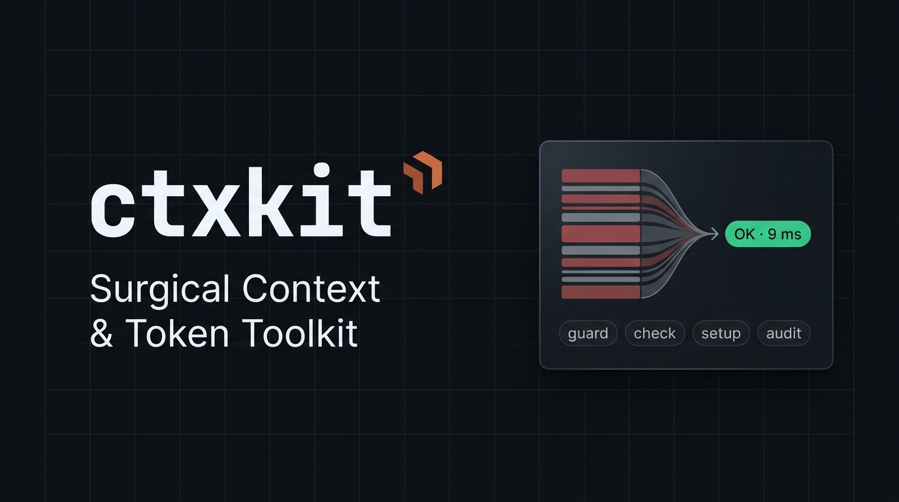

<p align="center">
  
</p>

<p align="center">
  <strong>English</strong> | <a href="README.ru.md">Русский</a>
</p>

<p align="center">
  <a href="#quick-start">Quick Start</a> ·
  <a href="#whats-inside">Modules</a> ·
  <a href="#setup-flags">Setup Flags</a> ·
  <a href="docs/ARCHITECTURE.md">Architecture</a> ·
  <a href="docs/RESEARCH.md">Research (30 Sessions)</a>
</p>

`ctxkit` is a single native Rust binary for **Claude Code**, **Claude Desktop**, **Antigravity**, and **DeepSeek Harness Desktop**. It stops agents from dumping whole files and raw compiler logs into context, blocks shell commands that mangle backslashes, and configures a low-waste model setup with one command.

Rust is only the runtime choice for fast startup (`9-14 ms` per hook call without spawning Node or Python). The toolkit targets **any project stack** (TypeScript/JS, Python, Go, Rust, config repositories): in an audit of 30 sessions, `60.5%` of incoming bloat came from reading large source files whole and running unfiltered grep in the shell.

## Where Limits Go

Findings from 30 recorded sessions (`26,256` turns; full breakdown in [the research note](docs/RESEARCH.md)):

| Baseline leak | How `ctxkit` addresses it |
|---|---|
| `95.3%` of turns ran on `Opus` or `Fable` (including Desktop presets and search) | `ctxkit setup` moves routine work to `Sonnet`, search to `Haiku` (`Explore`), and keeps `Fable` for escalations and `Opus` for `checker` |
| `60.5%` of `tool_result` chars came from full-file reads and unfiltered `rg`/`cat` | `PreToolUse` hook permits bounded slices (`<= 450` lines) and steers full reads to `Grep`, LSP, or `Explore` |
| `11.2%` came from verbose compiler and test runner logs | `ctxkit check <cmd>` collapses passing runs to `OK (<ms>)` and extracts root causes on failure |
| Mangled `\` escapes in inline one-liners triggered extra rewrite loops | Blocks backslash-bearing `node -e`, `python -c`, heredocs, and here-strings before execution; validates edited files on `PostToolUse` |

## Quick Start

**Requirements:** [Rust / Cargo](https://rustup.rs/) to build from source, [Node.js](https://nodejs.org/) to run `tests/guard.test.mjs`, `scripts/audit-sessions.mjs`, and `.js` `PostToolUse` syntax checks, and Python 3 (optional, for `.py` syntax checks).

### Windows (PowerShell)

```powershell
git clone https://github.com/d-ridelman/Loadout.git
cd Loadout/crates/ctxkit
.\scripts\install.ps1

# Open a new terminal so User PATH picks up %USERPROFILE%\.local\bin, or call it directly:
& "$env:USERPROFILE\.local\bin\ctxkit.exe" setup --dry-run
& "$env:USERPROFILE\.local\bin\ctxkit.exe" setup --with-rules --desktop --antigravity
```

### macOS and Linux

```bash
git clone https://github.com/d-ridelman/Loadout.git
cd Loadout/crates/ctxkit
./scripts/install.sh

~/.local/bin/ctxkit setup --dry-run
~/.local/bin/ctxkit setup --with-rules
```

Before changing `settings.json`, `CLAUDE.md`, `ccd-session-presets.json`, or `hooks.json`, `ctxkit setup` creates a timestamped backup under `backups/`. Custom `env`, permissions, enabled plugins, and third-party hooks are preserved, while legacy `claude-guard` and `no-inline-backslash` hook entries are upgraded in place.

## What's Inside

```text
  PreToolUse / PostToolUse              CLI
  ────────────────────────              ───
  Claude Code, Antigravity, DSH         ctxkit setup   ──▶  models, agents, hooks, diagnostics
        │                               ctxkit check   ──▶  compact tsc / pytest / go test / cargo
        ├──▶ guard.rs      (< 15 ms, blocks full reads > 28 KB / > 450 lines and broad grep)
        └──▶ backslash.rs  (catches stripped \ pre-tool; checks .json/.js/.py syntax post-tool)
```

| Module | Role | Behavior |
|---|---|---|
| `guard.rs` | Read and search guard | Blocks whole-file reads above `28 KB` / `450` lines (and `> 250 KB` without range) in `Read`, `read_file`, and DSH `read`, while skipping images, audio, video, and PDFs. A tail read from an offset passes only when the rest fits both caps. Blocks bare `cat`, `Get-Content`, and unfiltered recursive `grep -r`/`rg` (a search in one named file is fine) without touching pipes or `&&` chains. |
| `backslash.rs` | Escape and syntax guard | On `PreToolUse`, blocks backslash-heavy inline code (`node -e`, `python -c`, `perl -e`, `php -r`, `bash -c`), `sed -i`, heredocs, PowerShell here-strings, and throwaway patch scripts; syntax-check flags such as `node -c` are left alone. On `PostToolUse`, validates `.json` (skipping JSONC such as `tsconfig`, `.vscode/`, and `.devcontainer/`), `.js/.mjs/.cjs` (`node --check`), and `.py` (`ast.parse`). |
| `check.rs` | Output compressor (`ctxkit check`) | For `cargo check`/`clippy`/`build`, enables `--message-format=json` and prints up to 3 deduplicated `file:line:col` root causes. For `tsc`, `npm test`, `node --test`, `pytest`, or `go test`, prints `OK (<ms>)` on pass, or up to 30 key lines on failure with the full log saved to `%TEMP%/last-check.log` (`/tmp/last-check.log` on Unix). |
| `setup.rs` | Environment setup (`ctxkit setup`) | Applies `sonnet` + `advisorModel: fable` + `modelSettings.<model>.effortLevel: high` (plus the top-level `effortLevel`, which newer models ignore), writes `CLAUDE_CODE_SUBAGENT_MODEL` only with an explicit `--subagent`, creates `Explore.md` (`haiku`) and `checker.md` (`opus`), and audits CLI version, Claude plugins/`CLAUDE.md`/MCPs, and Antigravity MCPs/plugins/`agy` CLI model. |

## Setup Flags

Defaults are tuned for a 4-model advisor workflow (`fable` + `claude-sonnet-5-5`). Override them if your plan or client uses different model IDs (for example `--advisor opus` or `--advisor none`, and `--desktop-model <id>`).

| Flag | Purpose |
|---|---|
| `--dry-run` | Print planned edits and diagnostics without modifying files |
| `--profile <dir>` | Target a secondary profile directory (such as `~/.claude-work`) |
| `--advisor <name>` | Set advisor model (`fable` by default, `opus`, or `none` to omit) |
| `--desktop` | Switch Claude Desktop presets (`ccd-session-presets.json`) to `--desktop-model`. Run it with Claude Desktop fully quit (tray icon too): the running app keeps presets in memory and saves them over the file, so setup skips the write and warns while it runs |
| `--desktop-model <id>` | Desktop preset `modelId` override (default: `claude-sonnet-5-5`) |
| `--antigravity` | Register `ctxkit` in `~/.gemini/config/hooks.json` and audit Antigravity MCPs, plugins, and CLI model |
| `--dsh` | Write `~/.dsh/ctxkit-hooks.json` and mount the `@deepseek-ai/dsh-hooks-claude-code` bridge on it in the DeepSeek Harness `desktop` profile (`--dsh-home <path>` overrides `~/.dsh`); warns with the exact `pnpm add` command when the bridge package is missing |
| `--with-rules` | Insert or update the compact rule block in `CLAUDE.md` between `ctxkit` markers |
| `--force-agents` | Overwrite existing `Explore.md` and `checker.md` |
| `--no-stop-gate` | Do not wire the Stop gate and remove ours if present. By default `setup` adds a `Stop` hook: when a turn edited two or more code files (or made five or more edits) and neither `checker` nor the advisor ran after the last edit, the model is sent back once. Never twice in a row; `CTXKIT_GATE=0` mutes it per session |
| `--lang <en\|ru>` | Language for prompts, rules, and hooks (`en` default; `ru` sets `CTXKIT_LANG=ru` in `settings.json` and adds `--lang ru` in `hooks.json`) |

Hooks read `CTXKIT_LANG` (`en` default, `ru` for Russian messages) or `--lang en|ru`. Run `ctxkit setup --help` for the complete option list. Manual config templates sit in [`examples/`](examples/) using POSIX placeholder paths; run `ctxkit setup` to resolve OS-specific absolute paths automatically.

## How to roll back

```powershell
ctxkit setup --uninstall --dry-run     # what would be removed
ctxkit setup --uninstall               # remove it (add the same --profile / --antigravity / --dsh you used for setup)
```

`--uninstall` removes only what `ctxkit setup` added: our elements in the `PreToolUse` / `PostToolUse` / `Stop` hooks of `settings.json` (a hook is ours when the first two words of its command are a file named `ctxkit`, `claude-guard` or `no-inline-backslash`; other people's hooks in the same group stay), `env.CTXKIT_LANG`, the rules block between the `ctxkit` markers in `CLAUDE.md`, and our binary `hooks/ctxkit` (last, so no hook is left pointing at a missing file). With `--antigravity` / `--agy-file` it removes the `ctxkit` entry from `hooks.json`; with `--dsh` / `--dsh-home` it removes `ctxkit-hooks.json`, the ctxkit block in `cordis.patch.yml` and the rules block in `AGENTS.md`. Every file is backed up first; a second run changes nothing. `~/.local/bin/ctxkit` is deleted only when it is a byte copy of the current binary or of `hooks/ctxkit`, otherwise its path is printed. If the running binary cannot delete itself (Windows), it prints `remove manually: <path>` and still exits `0`.

It does **not** touch `model`, `advisorModel`, `effortLevel`, `modelSettings`, `env.CLAUDE_CODE_SUBAGENT_MODEL`, Claude Desktop presets or the `Explore.md` / `checker.md` agent files: the previous values are not known, and `modelSettings` can hold entries written by Claude Code itself. It prints their current values and the path to the latest and earliest `backups/settings.json.*.bak` (the earliest is most likely the state before the first setup) so you can copy the old values back by hand. Setup-only options (`--no-agents`, `--effort`, `--main-model`, ...) are rejected together with `--uninstall`.

## Diagnostics and report (`doctor`, `report`)

```powershell
ctxkit doctor [--json] [--profile <dir>] [--lang ru]   # why subagents are not called: hook, model, agents, rules block in CLAUDE.md
ctxkit report [--json] [--days 14] [--profile <dir>]   # per day: turns by model, subagent and advisor calls, tool_result volume
```

`doctor` exits `1` only on an `error` finding (for example the hook points to a deleted binary). Without the rules block (`ctxkit setup --with-rules`) the model is never told when to call `Explore`, `checker` or the advisor, and usually will not. `report` reads the transcripts under `<profile>/projects` and emits counters only (no text, paths or tool output); days are UTC. Both commands print JSON with `"schema": 1` for shells such as Loadout.

## Tests and Session Audit

```powershell
cargo test
cargo build --release
node tests/guard.test.mjs
```

Measure model distribution and tool output sizes across your own Claude Code transcripts:

```powershell
node scripts/audit-sessions.mjs 30
```

## Documentation

- [docs/ARCHITECTURE.md](docs/ARCHITECTURE.md) ([Russian](docs/ARCHITECTURE.ru.md)) details the four modules, Claude Code vs Antigravity hook contracts (`"ask"` vs `"allow"`), the DeepSeek Harness bridge, and the `toMcp` projection pattern.
- [docs/RESEARCH.md](docs/RESEARCH.md) ([Russian](docs/RESEARCH.ru.md)) covers the Anthropic and `@0xCodila` routing rules, critique of AST-MCP / heavy `PostToolUse` daemons, the 30-session audit tables, and five hidden config leaks.
