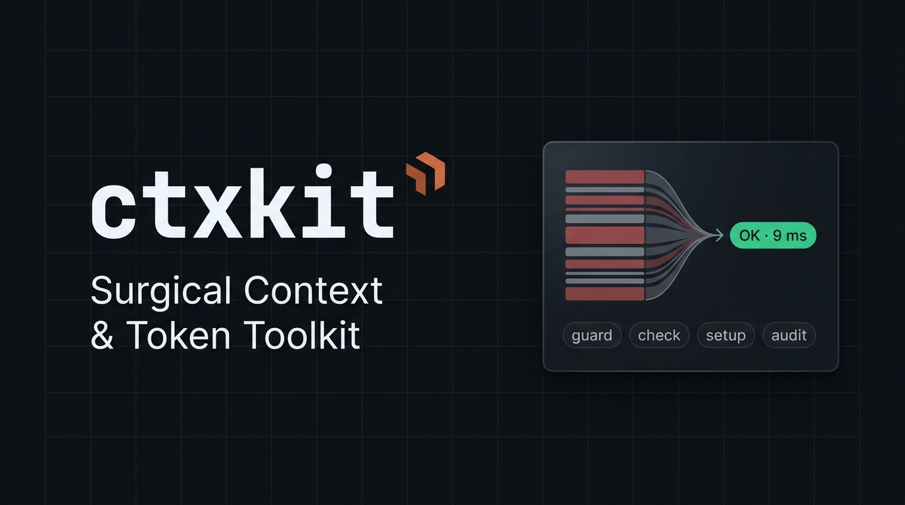

<p align="center">
  
</p>

<p align="center">
  <a href="README.md">English</a> | <strong>Русский</strong>
</p>

<p align="center">
  <a href="#быстрый-старт">Быстрый старт</a> ·
  <a href="#что-делает-ctxkit">Модули</a> ·
  <a href="#флаги-setup">Флаги <code>setup</code></a> ·
  <a href="docs/ARCHITECTURE.ru.md">Архитектура</a> ·
  <a href="docs/RESEARCH.ru.md">Исследование (30 сессий)</a>
</p>

Нативный бинарник на Rust для **Claude Code**, **Claude Desktop**, **Antigravity** и **DeepSeek Harness Desktop**. Режет лишнее раздутие контекста на чтении файлов и логах сборок, защищает обратные слеши в shell-командах и одной командой настраивает экономичную схему моделей.

Написан на Rust ради холодного старта за `9-14 ms` без запуска Node или Python на каждый хук. Подходит для **любых стеков** (TypeScript/JS, Python, Go, Rust, конфиги): в реальном аудите 30 сессий `60.5%` входящего мусора давали именно чтения больших `.ts`, `.js`, `.py` и `.md` файлов и вывод grep через консоль.

## Почему сгорают лимиты

По замеру 30 реальных сессий (`26 256` ходов, подробнее в [исследовании](docs/RESEARCH.ru.md)):

| Утечка в базовой настройке | Что делает `ctxkit` |
|---|---|
| `95.3%` ходов шли на `Opus` / `Fable` (включая Desktop-пресеты и поиск) | `ctxkit setup --main-model sonnet --advisor fable` переводит рутину на `Sonnet`, оставляя `Fable` на редкие консультации; setup добавляет также поиск на `Haiku` (`Explore`) и `Opus` для `checker` |
| `60.5%` `tool_result` уходило на загрузку длинных файлов и нефильтрованный `rg`/`cat` | `PreToolUse`-хук пропускает только чтения диапазонами (до `450` строк), направляя в `Grep`/`LSP` или `Explore` |
| `11.2%` занимали простыни компиляторов и тестов | `ctxkit check <cmd>` при успехе возвращает `OK (<ms>)`, при ошибке выделяет первопричины |
| Ошибки экранирования `\` в однострочниках давали холостые циклы перезаписи | Перехватывает `\` в `node -e`, `python -c`, heredoc и here-string до выполнения, а на `PostToolUse` проверяет синтаксис |

## Быстрый старт

**Зависимости:** [Rust / Cargo](https://rustup.rs/) для сборки из исходников, [Node.js](https://nodejs.org/) для тестов `tests/guard.test.mjs`, аудита сессий и синтаксической проверки `.js` в `PostToolUse`, а также Python 3 (опционально, для проверки `.py`).

### Windows (PowerShell)

```powershell
git clone https://github.com/d-ridelman/Loadout.git
cd Loadout/crates/ctxkit
.\scripts\install.ps1            # -DryRun: только показать, ничего не собирать, не копировать и не менять в PATH

# Скрипт добавит %USERPROFILE%\.local\bin в User PATH, не раскрывая остальные записи (%USERPROFILE%\go\bin
# остаётся как есть; значение пишется как REG_EXPAND_SZ). Для текущего окна укажи путь явно:
& "$env:USERPROFILE\.local\bin\ctxkit.exe" setup --lang ru --dry-run
& "$env:USERPROFILE\.local\bin\ctxkit.exe" setup --lang ru --with-rules --desktop --antigravity
```

### macOS и Linux

```bash
git clone https://github.com/d-ridelman/Loadout.git
cd Loadout/crates/ctxkit
./scripts/install.sh

~/.local/bin/ctxkit setup --lang ru --dry-run
~/.local/bin/ctxkit setup --lang ru --with-rules
```

Перед изменением `settings.json`, `CLAUDE.md`, `ccd-session-presets.json` или `hooks.json` создаётся резервная копия `backups/<имя>.<timestamp>.bak`. Пользовательские `env`, права доступа, плагины и сторонние хуки сохраняются; старые хуки `claude-guard` и `no-inline-backslash` автоматически заменяются на `ctxkit`.

Каждый файл, который переписывает `setup`, пишется атомарно: новое содержимое уходит во временный файл рядом и переименовывается поверх цели, поэтому сбой или полный диск оставляют прежний файл целым. Символьная ссылка пишется насквозь (остаётся ссылкой), права прежнего файла переносятся. Известное ограничение: `serde_json` хранит ключи объектов отсортированными, поэтому переписанный JSON (`settings.json`, `hooks.json`, файл пресетов) возвращается с ключами в алфавитном порядке и стандартными отступами; значения те же. Чтобы сохранить порядок, нужен признак `preserve_order` у `serde_json`, а он один на весь Cargo-воркспейс и заодно изменил бы то, что пишет `loadout-core` при копировании значений (сборка всего воркспейса и `cargo test -p loadout-core` дали бы разный вывод), поэтому он выключен.

Прежде чем копировать бинарь или что-то записывать, `setup` читает каждый файл, который собирается менять, и отказывается, если не может с ним работать (`settings.json` странной формы, `CLAUDE.md` / `AGENTS.md` при `--with-rules` не в UTF-8 или с задвоенным либо непарным маркером ctxkit (так могла оставить прежняя версия; `doctor` предупреждает об этом находкой `rules_markers` с путём к файлу), битый файл пресетов Desktop или `hooks.json` Antigravity, `cordis.patch.yml` DeepSeek Harness с половинкой блока или верхним уровнем не в виде списка, битый `ctxkit-hooks.json`). Отказ завершается кодом `1` и не оставляет ни скопированного бинаря, ни переписанных файлов, ни бэкапов.

## Что делает `ctxkit`

```text
  PreToolUse / PostToolUse              CLI
  ────────────────────────              ───
  Claude Code, Antigravity, DSH         ctxkit setup   ──▶  модели, агенты, хуки, диагностика
        │                               ctxkit check   ──▶  сжатие tsc / pytest / go test / cargo
        ├──▶ guard.rs      (< 15 ms, блокирует чтение целиком > 28 KB / > 450 строк и широкий grep)
        └──▶ backslash.rs  (ловит потерю \ до вызова и проверяет .json/.js/.py после записи)
```

| Модуль | Назначение | Ключевые детали |
|---|---|---|
| `guard.rs` | Защита чтения и поиска | Блокирует целиком файлы крупнее `28 KB` / `450` строк (и `> 250 KB` без диапазона) в `Read`, `read_file` и `read` (DSH), не трогая изображения, видео, аудио и PDF. Чтение хвоста от смещения проходит, только если остаток укладывается в оба порога. Останавливает голые `cat`, `Get-Content` и широкий `grep -r`/`rg` без фильтров (поиск в одном названном файле разрешён), не мешая пайпам и `&&`. |
| `backslash.rs` | Контроль `\` и синтаксиса | На `PreToolUse` ловит `\` в inline-коде (`node -e`, `python -c`, `perl -e`, `php -r`, `bash -c`), `sed -i`, heredoc, here-string и patch-скриптах; флаги проверки синтаксиса вроде `node -c` не трогает. На `PostToolUse` проверяет `.json` (пропуская `tsconfig`, `.vscode/` и `.devcontainer/`; любой другой файл, который не строгий JSON, разбирается ещё раз как JSONC, поэтому `turbo.json` или `biome.json` с комментариями и хвостовыми запятыми проходят, а блокируется только файл, не разобравшийся обоими способами), `.js/.mjs/.cjs` (`node --check`) и `.py` (`ast.parse`). |
| `check.rs` | Сжатие логов (`ctxkit check`) | Для `cargo check`/`clippy`/`build` читает JSON-вывод и выводит до 3 уникальных первопричин `file:line:col`. Для `tsc`, `npm test`, `node --test`, `pytest`, `go test` при успехе даёт `OK (<ms>)`, при ошибке до 30 строк и полный лог в `%TEMP%/last-check-<pid>.log` (`/tmp/...` на Unix; путь печатается, логи старше суток удаляются при следующей записи). В Windows команда запускается напрямую (`npm` находится как `npm.cmd` через `PATH` / `PATHEXT`), поэтому `&`, `\|`, `%`, `^` в её аргументах доходят без изменений; через `cmd.exe /d /c` идёт только имя, которое не файл (встроенная команда `cmd`, например `dir`). |
| `policy.rs`, `shell.rs`, `commit.rs`, `irreversible.rs`, `stray.rs`, `slots.rs`, `dupes.rs` | Политики (см. «Политики») | `policy.rs` читает `<профиль>/ctxkit.json`; `shell.rs` — лексер Bash / PowerShell, общий для командных политик (кавычки, `$(...)`, heredoc, here-string); `commit.rs`, `irreversible.rs` и `stray.rs` — правила хуков, `slots.rs` — замок слота у `ctxkit check`, `dupes.rs` — поиск повторяющихся правил в `doctor`. Всё выключено, пока `setup --policy` не включит. |
| `setup.rs` | Автонастройка (`ctxkit setup`) | Подключает хуки, создаёт `Explore.md` (`haiku`) и `checker.md` (`opus`), с `--with-rules` добавляет блок правил, диагностирует CLI (`< 2.1.321`), плагины, `CLAUDE.md`, глобальные MCP и конфиги Antigravity. Модель, советник и effort ставятся **только флагами** `--main-model`, `--advisor`, `--effort` (прежняя схема: `ctxkit setup --main-model sonnet --advisor fable --effort high`); `CLAUDE_CODE_SUBAGENT_MODEL` пишется только при `--subagent`. Каждый запуск, в том числе с `--dry-run`, печатает «было -> стало» (или «kept») по каждой настройке. |

## Флаги `setup`

`setup` сам не меняет твой выбор моделей: `model`, `advisorModel` и effort пишутся, только когда передан флаг, иначе остаются как есть (отсутствующий ключ остаётся отсутствующим), а в выводе стоит строка вида `model: opus (kept; pass --main-model sonnet to set)` (с `--lang ru`: `model: opus (оставлено; чтобы задать, передайте --main-model sonnet)`). Для схемы, под которую настроен ctxkit (советник `fable` и основная `claude-sonnet-5-5`), запусти `ctxkit setup --main-model sonnet --advisor fable --effort high`. Окно Loadout передаёт `--advisor`, только если советник выбран в форме (по умолчанию «не менять»), и никогда не передаёт `--main-model` и `--effort`.

| Флаг | Назначение |
|---|---|
| `--dry-run` | Показать план правок и диагностику без записи на диск |
| `--profile <dir>` | Выбрать отдельный профиль (например, `~/.claude-work`) |
| `--main-model <name>` | Записать `model` (например, `sonnet`) |
| `--advisor <name>` | Записать `advisorModel` (`fable`, `opus`, либо `none`, чтобы убрать) |
| `--effort <level>` | Записать effort: `modelSettings.<модель>.effortLevel` для `--main-model` или твоей `model` (известная модель, `low`/`medium`/`high`/`xhigh`), верхнеуровневый `effortLevel` и effort пресетов Desktop при `--desktop` |
| `--desktop` | Записать `modelId` (`--desktop-model`) в пресеты Claude Desktop (`ccd-session-presets.json`); effort пресета меняется только с `--effort`. Запускать при полностью закрытом Claude Desktop, включая значок в трее: открытое приложение держит пресеты в памяти и перезаписывает файл, поэтому setup в этом случае ничего не пишет и предупреждает |
| `--desktop-model <id>` | Идентификатор модели в пресетах Desktop (по умолчанию `claude-sonnet-5-5`) |
| `--antigravity` | Зарегистрировать `ctxkit --agy` в `~/.gemini/config/hooks.json` (к своему `--hook-cmd` дописывается ` --agy`) и проверить MCP, плагины и модель `agy` CLI |
| `--dsh` | Записать `~/.dsh/ctxkit-hooks.json` и подключить к нему мост `@deepseek-ai/dsh-hooks-claude-code` в профиле `desktop` DeepSeek Harness (`--dsh-home <path>` заменяет `~/.dsh`); если пакета моста нет, выводит точную команду `pnpm add` |
| `--with-rules` | Добавить в `CLAUDE.md` блок правил (включая триггер `/advisor`) между маркерами `ctxkit`. Блок собирается из одного источника: кроме строк про команду моделей в него попадает по короткой строке на каждую включённую в `ctxkit.json` политику и затем твои пункты `rules` как есть (без перевода); выключил политику — запусти снова, и её строка уйдёт. Повторный запуск без изменений ничего не меняет |
| `--force-agents` | Перезаписать уже существующие `Explore.md` и `checker.md` |
| `--no-stop-gate` | Не подключать шлюз Stop и убрать наш, если он есть. По умолчанию `setup` добавляет хук `Stop`: если за ход правились два и более файла с кодом (или сделано пять и более правок), а после последней не вызван ни `checker`, ни advisor, модель один раз возвращается к работе. Два раза подряд не срабатывает; `CTXKIT_GATE=0` отключает на сессию. В сообщении названо только то, что есть: `checker` (`agents/checker.md` в профиле или проекте) и/или advisor (`advisorModel` в `settings.json`); если нет ни того, ни другого (например, `--advisor none --no-agents`), шлюз молчит |
| `--policy <list>` | Какие политики из `ctxkit.json` включены (`commit-hygiene`, `confirm-irreversible`, `stray-files`, `build-slots=N`; `none` выключает все). Без флага не меняются; см. «Политики» |
| `--lang <en\|ru>` | Язык шаблонов, хуков **и всего, что печатают `setup` и `setup --uninstall`** (`en` по умолчанию; при `ru` пишет `CTXKIT_LANG=ru` в `settings.json` и `--lang ru` в `hooks.json`). Разметка, по которой разбирают вывод инструменты, одинакова на обоих языках: `[dry-run]`, `[warn]`, `[note]`, `[ok]`, `[info]`, `ERR:`, ` -> ` в «было -> стало», флаги, пути и имена моделей |

Язык сообщений самих хуков задаётся переменной `CTXKIT_LANG` (`en` по умолчанию, `ru` для русского) или флагом `--lang`. Полная справка вызывается через `ctxkit setup --help`. В [`examples/`](examples/) лежат шаблоны конфигов с POSIX-заглушками путей; для реальной установки надёжнее запускать `ctxkit setup`, который подставляет точный абсолютный путь под вашу ОС.

## Как откатить

```powershell
ctxkit setup --uninstall --dry-run     # что будет убрано
ctxkit setup --uninstall               # убрать (с теми же --profile / --antigravity / --dsh, что были у setup)
```

`--uninstall` убирает только то, что добавил `ctxkit setup`: наши элементы в хуках `PreToolUse` / `PostToolUse` / `Stop` в `settings.json` (хук наш, если его команда запускает файл `ctxkit`, `claude-guard` или `no-inline-backslash`: первое слово либо второе после `node`/`bun`/`deno`/`npx`/`python`; поэтому `node C:/x/no-inline-backslash.mjs` наш, а `node C:/tools/ctxkit-helper/stop.js` и `logger.exe ctxkit` нет; чужие хуки, в том числе из той же группы, остаются; хук, который вы написали сами и который вызывает `ctxkit`, например `ctxkit report` в хуке Stop, тоже считается нашим, так что держите такие команды в скрипте с другим именем), `env.CTXKIT_LANG`, блок правил между маркерами `ctxkit` в `CLAUDE.md` и свой бинарь `hooks/ctxkit` (последним, чтобы не осталось хука на несуществующий файл). С `--antigravity` / `--agy-file` убирает запись `ctxkit` из `hooks.json`; с `--dsh` / `--dsh-home` убирает `ctxkit-hooks.json`, блок ctxkit в `cordis.patch.yml` и блок правил в `AGENTS.md`. Перед каждой записью делается бэкап; повторный запуск ничего не меняет. Если бэкап хранит файл таким, каким он был до setup (без блока и хука ctxkit), а сам файл с тех пор больше ничем не отличается (остальное содержимое то же), откат возвращает байты этого бэкапа: переводы строк CRLF, отсутствие финального перевода строки, лишние пустые строки, порядок ключей и пустой `"hooks": {}` возвращаются в точности (это `settings.json`, `CLAUDE.md`, `AGENTS.md` и `cordis.patch.yml` DeepSeek Harness). Если ты правил файл после setup (модель, строку текста), вырезаются только наши части, с переводами строк самого файла. `CLAUDE.md`, `AGENTS.md` или `settings.json`, которые создал сам setup (бэкапа нет или в бэкапах только наши части), удаляются после бэкапа, а не остаются пустым файлом или `{}`; `settings.json`, который до setup был `{}`, остаётся `{}`. `~/.local/bin/ctxkit` удаляется, только если это побайтовая копия текущего бинаря или `hooks/ctxkit`, иначе печатается путь. Если запущенный бинарь не может удалить сам себя (Windows), он печатает `удалите вручную: <путь>` и всё равно завершается с кодом `0`.

Откат **не трогает** `model`, `advisorModel`, `effortLevel`, `modelSettings`, `env.CLAUDE_CODE_SUBAGENT_MODEL`, пресеты Claude Desktop и файлы агентов `Explore.md` / `checker.md`: прежние значения неизвестны, а в `modelSettings` бывают записи самого Claude Code. Он печатает их текущие значения и пути к последнему и самому раннему `backups/settings.json.*.bak` (самый ранний, скорее всего, хранит состояние до первого setup; бэкап, который сделал сам откат, помечен «сделан этим запуском» и хранит состояние до отката), чтобы вернуть старое вручную. Опции, нужные только для установки (`--no-agents`, `--effort`, `--main-model` и т. д.), вместе с `--uninstall` отвергаются.

## Политики

Правила, которые владелец держит в `CLAUDE.md` текстом («без `Co-Authored-By` в коммитах», «спрашивай перед `git push`»), хуки могут проверять сами. Политики **выключены, пока ты их не включишь**: ничего не включается молча, а `setup` без `--policy` файл не создаёт и не меняет.

```powershell
ctxkit setup --policy commit-hygiene,confirm-irreversible,stray-files,build-slots=2   # включены ровно эти
ctxkit setup --policy none                                                           # всё выключено
```

Выбор лежит в `<профиль>/ctxkit.json` (`CLAUDE_CONFIG_DIR`, иначе `~/.claude`); хуки и `ctxkit check` читают его при каждом вызове:

```json
{
  "policies": { "commit_hygiene": true, "confirm_irreversible": true, "stray_files": true, "build_slots": 2 },
  "stray_patterns": ["draft*.md"],
  "rules": ["Субагентам, которые правят код, задавай model: \"sonnet\", никогда haiku"]
}
```

`--policy` перечисляет включённые политики; все остальные выключаются, `setup` печатает «было -> стало» по каждой (и с `--dry-run`). Файл пишется атомарно после бэкапа; твои ключи (`stray_patterns`, `rules`, любые другие) сохраняются, но `serde_json` сортирует ключи по алфавиту, поэтому порядок в файле меняется. Перед записью `setup` отказывает на `ctxkit.json`, который не разбирается (его читают и `--policy`, и `--with-rules`). Нет файла или он битый — все политики выключены, хуки молчат; `doctor` сообщает о битом (`policies`, `warn`). `--with-rules` кладёт в блок правил по одной строке на каждую включённую политику и твои пункты `rules` как есть (см. «Флаги `setup`»). Политика, которая запрещает, отвечает `deny`; та, что спрашивает, отвечает `ask`, и Claude Code показывает обычный запрос разрешения.

| Политика | Что делает | Как включить | Как выключить | Чем проверено |
|---|---|---|---|---|
| `stray_files` | `PreToolUse` `Write` (также DSH `write`, Antigravity `write_file`): отвечает **`ask`**, когда имя файла похоже на отчёт или временный файл (`report*.md`, `*-report.md`, `analysis*.md`, `*-analysis.md`, `summary*.md`, `notes*.md`, `*.tmp`, `*.bak`, любой регистр), а сам файл лежит прямо в корне проекта (`cwd` хука) или в корне профиля; в причине сказано, что владелец просит отчёты в чат, а не в файл. Файлы в подкаталогах (`docs/`, `tests/`) не трогаются. `stray_patterns` в `ctxkit.json` добавляет шаблоны (единственный подстановочный знак — `*`, сравнивается с именем файла). Относительный путь разрешается от `cwd`, `.`/`..` — по тексту, каталоги сравниваются без учёта регистра и направления слэшей. `Edit` не охвачен | `--policy stray-files` | `--policy none` (или список без неё) | юнит-тесты `stray.rs` (glob; 15 путей, о которых спрашивает, и 13, которые пропускает; свои шаблоны), `tests/guard.test.mjs` (Claude Code, `--dsh`, `--agy`, относительный путь, корень профиля, выключено по умолчанию) |
| `build_slots` | `ctxkit check` берёт один из N слотов (файлы-замки в `%TEMP%/ctxkit-slots`, на Unix `$TMPDIR`) перед запуском команды, поэтому проверки с одной и той же временной папкой одновременно идут не больше чем в N. Набор слотов свой у каждой временной папки, а не у машины: у другого пользователя или у песочницы с другим `TEMP` / `TMPDIR` он свой. Свободного слота ждёт до 10 минут, сразу и затем раз в 15 секунд печатая в stderr `жду слот сборки (N занято)`; после 10 минут запускает команду без слота. Слот — блокировка операционной системы на всё время жизни процесса: выход, паника, kill и Ctrl+C её снимают, так что умерший процесс слот не держит (pid и время старта в `slot-<n>.info` — для людей; владелец старше 2 часов считается зависшим, и вместо него берётся дополнительный файл слота). Битые или непригодные файлы слотов означают «без слота и без ожидания». Время, которое печатает `check`, ожидание не включает. Без политики `check` работает как раньше | `--policy build-slots=2` (N от 1 до 64; просто `build-slots` — это 2) | `--policy none` (или список без неё) | юнит-тесты `slots.rs` (6 потоков на 2 слота, освобождение, таймаут, файлы умершего процесса, зависший владелец, мусор и папка на месте замка), `tests/guard.test.mjs` (3 параллельных `ctxkit check`: идут не больше 2, сообщение об ожидании, выключено — без лимита; убитый владелец отдаёт слот) |
| `confirm_irreversible` | `PreToolUse` Bash / PowerShell: отвечает **`ask`** (Claude Code показывает обычный запрос разрешения с причиной) на `git push` (любой; форс-пуш называется отдельно: `--force`, `-f`, `--force-with-lease`, `+ref`), `git push --delete` / `-d` / `origin :old` (называется удалением на удалённом), `git reset --hard`, `git clean -f`, `git branch -D` (и `--delete --force`), `git checkout -- .` / `git restore .`, `git stash drop` / `clear`, `git reflog expire --expire=now` (или `=all`, `--expire-unreachable=now`) и `git reflog delete`, `git gc --prune=now` / `=all`, `git prune`, `git worktree remove --force`, `git update-ref -d`, `rm -rf` (и `-r -f`, `--recursive --force`), `find ... -delete` и `find ... -exec rm -rf {} +`, PowerShell `Remove-Item -Recurse -Force` под любым алиасом (`rm`, `ri`, `del`, `erase`, `rd`, `rmdir`; параметры можно сокращать: `-r -fo`), cmd.exe `rd /s /q`, `rmdir /s /q`, `del /s /q`, `erase /s /q` внутри `cmd /c` / `cmd //c` / `cmd /k` (ключи в любом регистре и слитно: `/S/Q`) и рекурсивное удаление корня диска или домашнего каталога (`rm -r`, `Remove-Item`, `rd /s`). Команда разбирается (цепочки `&&` `;` `\|`, `$(...)`, кавычки, `VAR=x`, обёртки `sudo`, `doas`, `env`, `command`, `nohup`, `exec`, `time`, `nice`, `timeout 30`, `xargs`, вложенные `bash -lc`, `sh -c`, `pwsh -c`, `powershell -Command`, `cmd /c` со своими правилами кавычек: `'` и `;` там простые символы, `^` экранирует, аргумент, с которого внешняя оболочка сняла кавычки, закавычивается обратно, как его несёт командная строка Windows, а `if exist x rd /s /q x` читается сквозь `if`): те же слова в сообщении коммита, `echo`, пути, комментарии или теле heredoc не считаются; `--dry-run`/`-n`, `git clean -n`, `git restore --staged .`, `git stash list` / `pop` / `push -m drop`, `git reflog expire` со сроком по умолчанию или с `--dry-run`, `-h` / `--help` любой подкоманды git, `git gc` без `--prune=now`, `git worktree remove` без `--force`, одиночный `rm -r dir`, `rm file.txt`, `find . -name x` без `-delete`, `Remove-Item file` без `-Recurse -Force`, `Remove-Item ... -WhatIf`, `rd /s dir` без `/q` (cmd сам спросит «Are you sure») и голые `rd /s /q` / `del /q` в PowerShell (там это `Remove-Item` с лишними аргументами, он падает с ошибкой и ничего не удаляет) не спрашиваются. `git branch -d` (малая `d`) осознанно не спрашивается: git сам отказывается удалять не слитую ветку, а слитая остаётся в истории. Блок («deny») другой политики сильнее вопроса | `--policy confirm-irreversible` | `--policy none` (или список без неё) | юнит-тесты `irreversible.rs` (200+ строк команд, положительные и отрицательные; ложные проверяются в обоих диалектах), `shell.rs` (кавычки cmd), `tests/guard.test.mjs` (Claude Code, `--dsh`, `--agy`, один JSON в ответе, форма `hookSpecificOutput.permissionDecision = "ask"`) |
| `commit_hygiene` | `PreToolUse` Bash / PowerShell: блокирует `git commit`, в **сообщении** которого есть трейлер `Co-Authored-By:`, строка `🤖 Generated` или строка, начинающаяся с `Generated with` (в любом регистре), и просит убрать эти строки. Проза, которая лишь упоминает эти слова («explain the Co-Authored-By policy», «stubs generated with protoc»), проходит: ложный блок честного коммита обходится дороже пропущенного трейлера. Сообщение берётся из `-m` (в том числе несколько, `-am`, `-m"..."`), `--message=`, `--trailer`, `-F -` с heredoc или `<<<`, читаемого `-F <файл>` и из скриптов `bash -c` / `pwsh -Command`. Не срабатывает на `git log`, `--amend --no-edit`, имя ветки, пути после `--`, `--author=`, `echo` и на команду, которую нельзя разобрать (незакрытая кавычка) | `--policy commit-hygiene` | `--policy none` (или список без неё) | юнит-тесты `commit.rs` и `shell.rs` (кавычки, heredoc внутри `"$(cat <<'EOF' ...)"`, here-string PowerShell, 40+ строк команд), `tests/guard.test.mjs` (Claude Code, `--dsh`, `--agy`, выключено по умолчанию, битый файл) |

Что такое `ask` и где он заканчивается (справочник хуков Claude Code, https://code.claude.com/docs/en/hooks, и страница режимов разрешений, прочитаны 2026-11-16): ответ `PreToolUse` — `{"hookSpecificOutput": {"hookEventName": "PreToolUse", "permissionDecision": "ask", "permissionDecisionReason": "..."}}`, в документации сказано `"ask" prompts the user to confirm` (в запросе есть метка `[settings]` с источником хука); при нескольких хуках приоритет `deny > defer > ask > allow`. **Что делает `ask` хука при `bypassPermissions` и `dontAsk` вообще, документация не говорит**: страница режимов разрешений называет первый режим так: «disables permission prompts and safety checks so tool calls execute immediately» (запросы и проверки отключены, вызовы выполняются сразу) и перечисляет, что и там спрашивает (явные правила `ask`, `AskUserQuestion`, `rm` по критическим путям; `ask` хука в списке нет), а про `dontAsk` сказано лишь, что он отклоняет вызовы, «matching your explicit ask rules rather than prompting» (подпадающие под явные правила `ask`); ответа нет ни в разделах *Skip all checks with bypassPermissions mode*, *Actions no mode auto-approves* и `dontAsk`, ни в справочнике хуков (*PreToolUse decision control*). Единственная близкая фраза: среди причин, по которым запрос для критических путей остаётся включённым, названо «A PreToolUse hook answers ask for a removal». В других местах сказано: в режиме auto «a PreToolUse hook's "ask" normally sends the tool call to the permission prompt, and the classifier doesn't decide it»; в запуске `-p`, где отвечать некому, вызов отклоняется, а «Claude reads the reason in the tool result instead» (Claude читает причину в результате инструмента). Живая проверка ниже закрывает вопрос для `claude` 2.1.325: `ask` хука сработал во всех проверенных режимах, включая `bypassPermissions` и `--dangerously-skip-permissions`. `commit_hygiene` — это `deny`, он заблокировал коммит в каждом режиме.

Проверено вживую на `claude` 2.1.325, Windows 11 с Git Bash, 2026-11-16, хук собран из коммита `4bd6e98`. Устройство: временный профиль, настроенный `ctxkit setup --profile <tmp> --policy confirm-irreversible,stray-files,commit-hygiene` (вне `<tmp>` ничего не изменилось: у `~/.claude.json` и `~/.local/bin` прежние даты); хук в `--settings` (`matcher: Bash|Write`) — маленькая обёртка, которая запускает `<tmp>/hooks/ctxkit.exe` с `CLAUDE_CONFIG_DIR=<tmp>` только для хука и пишет его ответ в журнал; каждый запуск — `claude -p "<задача>" --model haiku --max-turns 3 --no-session-persistence --setting-sources project --settings <файл> --allowedTools Bash Write --output-format stream-json --verbose` плюс флаг режима, во временном репозитории с bare-удалённым рядом. «Выполнилось?» определяется по состоянию (`main` удалённого по `git ls-remote`, файл на диске, число коммитов), а не по словам модели; в журнале хука в каждой строке ожидаемый ответ. Контрольные запуски — та же обёртка с пустым профилем (все политики выключены).

| Режим | Вызов | Ответ хука | Выполнилось? | Что увидела модель (`tool_result`) |
|---|---|---|---|---|
| `-p`, default, политики выключены (контроль) | `git push origin main` | нет | **Да** | `To ../remote.git  cd99889..d1dd0b8  main -> main` |
| `-p`, default | `git push origin main` | `ask` | Нет | ошибка `Hard to undo: git push. Confirm to run it (policy confirm_irreversible in ctxkit.json).`; вызов есть в `permission_denials` |
| `-p --permission-mode acceptEdits` | то же | `ask` | Нет | та же ошибка |
| `-p --permission-mode bypassPermissions` | то же | `ask` | Нет | та же ошибка |
| `-p --dangerously-skip-permissions` | то же | `ask` | Нет | та же ошибка |
| `-p --permission-mode dontAsk` | то же | `ask` | Нет | та же ошибка |
| `-p --permission-mode plan` | модель не вызвала Bash, только записала файл плана | (вызова Bash нет) | Нет | остановил сам режим plan, до хука не дошло |
| `-p`, default, политики выключены (контроль) | `Write report.md` в корне проекта | нет | **Да** | `File created successfully at: ...\report.md` |
| `-p`, default / `acceptEdits` / `bypassPermissions` | `Write report.md` | `ask` | Нет, файла нет | ошибка «report.md looks like a report or scratch file in the project root. The owner wants reports in the chat, not in a file (policy stray_files in ctxkit.json): ...» |
| `-p --permission-mode plan` | модель записала только файл плана | (вызова для `report.md` нет) | Нет | остановил режим plan |
| `-p`, default / `acceptEdits` / `bypassPermissions` | `git commit --allow-empty -m "test" -m "Co-Authored-By: Bot <bot@example.com>"` | `deny` | Нет, число коммитов то же | ошибка «PreToolUse:Bash hook error: The commit message has a Co-Authored-By or Generated with line. Remove those lines ...» |
| `-p --permission-mode plan` | тот же коммит | (вызова Bash нет) | Нет | остановил режим plan |
| `-p`, default, политики выключены (контроль) | тот же коммит | нет | **Да**, новый коммит | `[main 345ec84] test` |
| запрос отвечает хост: `--input-format stream-json --permission-prompt-tool stdio`, default, хост отвечает deny | `git push origin main` | `ask` | Нет | хост получил `can_use_tool` с `"decision_reason": "Hard to undo: git push. ..."`, `"decision_reason_type": "hook"`, `"decision_reason_hook_event": "PreToolUse"`, `"decision_reason_hook_source": "settings"`; модель увидела `denied by the test driver` |
| то же, хост отвечает allow | то же | `ask` | **Да** | тот же запрос; после «allow» push прошёл (`d1dd0b8..246e689`) |
| то же, `--permission-mode bypassPermissions`, хост отвечает deny | то же | `ask` | Нет | тот же запрос: в `bypassPermissions` вызов всё равно ушёл на подтверждение |
| то же, `--permission-mode acceptEdits`, хост отвечает deny | то же | `ask` | Нет | тот же запрос |

Итог для 2.1.325: `ask` хука — настоящий вопрос в каждом проверенном режиме. В `-p`, где отвечать некому, он работает как отказ, и модель читает нашу причину; когда отвечать есть кому (хост сессии stream-json получает тот же запрос `can_use_tool`, из которого строится диалог), вызов ждёт ответа и выполняется только после «allow»; `bypassPermissions` его не пропускает. Не проверено: сам диалог в терминальном интерфейсе (запрос дошёл до хоста, его вид на экране не смотрели), режим `auto`, версии старше и новее 2.1.325; в документации это поведение не описано и может измениться. Рекомендация: то, что не должно случиться никогда, держи в политике с `deny` (как `commit_hygiene`), а не в `ask`; после обновления `claude` повтори один запуск в `bypassPermissions`, как выше. Попутная находка: в режиме plan модель пишет свой план в `plans/` настоящего профиля (`~/.claude/plans`) даже при `--setting-sources project`; три файла плана от этих запусков после проверки удалены.

Другие клиенты вживую не проверялись (покрыт только ответ хука в `tests/guard.test.mjs`): Antigravity: `--agy` отвечает `{"decision": "ask", "reason": "..."}` (документированные значения — `allow`, `deny`, `ask`, `force_ask`); чистый вызов и так получал `{"decision": "ask"}`, поэтому для этих двух политик хук лишь добавляет причину. DeepSeek Harness: мост повторяет ответ Claude Code, учитывает ли он `ask`, не проверялось.

Пределы разбора (молча пропускается, ложная тревога дороже промаха): алиасы и функции оболочки, скрипты (`./deploy.sh`, который делает push) и алиасы `git` (`git config alias.p push`) не раскрываются; имена и аргументы, которые собираются при запуске (`$cmd -rf x`, `git $sub`, `eval`, `Invoke-Expression`, `& $exe`), не видны; команда с незакрытой кавычкой пропускается; `$(...)` в теле heredoc без кавычек у разделителя (`cat <<EOF`) не читается; обёртки вне списка (`stdbuf`, `ionice`, `watch`, `wsl`, `start`, `Start-Process`) прячут команду за собой; `find -exec sh -c '...'` внутрь `sh -c` не заглядывает; в cmd скобка посреди команды (`echo (rd /s /q x)`) делит её, как группа, и может дать лишний вопрос; не охвачены `git checkout -f`, `git switch --discard-changes`, `git tag -d`, `rimraf`, `shred`, `format`, `diskpart`.

Откат: `ctxkit setup --policy none` выключает все политики и оставляет файл; `ctxkit setup --uninstall` убирает секцию `policies`, а файл целиком — только если его создал `setup` (такой файл помечен `"created_by": "ctxkit setup"`) и твоего в нём ничего нет. Иначе твои ключи остаются, и вывод их называет.

## Безопасный отказ

Хук не должен мешать работе. В режиме хука `ctxkit` при любом сбое завершается с кодом `0` и пустым stdout (вызов идёт дальше; в режиме `--agy`, который `ctxkit setup --antigravity` пишет в команду, вместо этого печатается `{"decision":"ask"}`, потому что документация хуков Antigravity требует JSON с `decision`, см. [docs/ARCHITECTURE.ru.md](docs/ARCHITECTURE.ru.md)): пустой или битый JSON, нет полей или они не того типа, неизвестное событие, нет транскрипта для шлюза Stop, ввод больше 64 МиБ, не-UTF-8, даже паника. Блокирует только осознанное срабатывание правила (`deny` для `PreToolUse`, `block` для `PostToolUse` / `Stop`; включаемые политики могут ещё отвечать `ask`); с кодом `2` не выходит никогда. `ctxkit setup` пишет `"timeout": 10` у каждого добавленного хука (Claude Code, Antigravity, DeepSeek Harness).

Аварийные выключатели: `CTXKIT_GUARD=0` заставляет хуки `PreToolUse` / `PostToolUse` сразу выходить без вывода; `CTXKIT_GATE=0` делает то же для шлюза Stop. Значение читается по одному правилу у обоих: пробелы по краям не важны, `0`, `off`, `false`, `no` (в любом регистре) выключают хук, любое другое значение, в том числе пустое, оставляет его включённым. Задавай в окружении сессии (например, `CTXKIT_GUARD=0 claude`). Убрать хуки совсем: «Как откатить».

Что делает сам Claude Code, когда хук ведёт себя плохо (справочник по хукам, https://code.claude.com/docs/en/hooks, прочитан 2026-11-16; таблица — это документация, наш живой прогон во второй таблице ниже):

| Сценарий | Блокирует ли вызов инструмента | Документация Claude Code |
|---|---|---|
| Бинарь хука не найден / не запускается | Нет, неблокирующая ошибка, вызов идёт дальше | "Non-blocking error: your hook exits with any other code, or fails in some other way, such as not starting or printing invalid JSON. The action goes ahead"; "Without onFailure set, the same missing script is a non-blocking error and ls runs." |
| Код выхода `1` (или любой, кроме `0` / `2`) | Нет | "Exit code 1 without valid JSON output is a non-blocking error unless the hook is one whose failure blocks the action, even though 1 is the conventional Unix failure code." |
| Код выхода `2` | Да, на `PreToolUse` вызов блокируется, причина берётся из stderr | "Blocking error: your hook exits 2. On events that can block, Claude Code stops the action." |
| Таймаут | На `PreToolUse` нет | "On PreToolUse, a timed-out command, http, or mcp_tool hook doesn't block the tool call, except for hooks whose failure blocks the action. The call continues through the normal permission flow, so don't count on a stalled hook to act as a gate." |
| Любой сбой при `"onFailure": "block"` у хука (v2.1.295+, включается явно) | Да | "With "block" set, a failure does what exit code 2 does on that event" |
| Windows без Git Bash, `PreToolUse`-хук в shell-форме, `onFailure` не задан | Может блокировать | "On Windows without Git Bash, a shell-form PreToolUse or PermissionRequest command hook that fails with onFailure unset can instead block the tool call." |

Две находки. Во-первых, неверный путь к хуку работу не останавливает (его показывает находка `hooks` уровня `error` в `doctor`: «хук указывает на несуществующий бинарь»); цена в том, что защита молча перестаёт работать. Во-вторых, строка про Windows без Git Bash (только документация, вживую не проверена: на этой машине Git Bash есть). Упавший хук, который там блокирует вызов, закрыт: с Claude Code 2.1.295 документация называет лекарством `"onFailure": "continue"` («The call should go ahead when the hook fails»), и `ctxkit setup` теперь пишет его в свои хуки `PreToolUse` и `PostToolUse` (не в `Stop`, где по документации поле не действует, и не в файлы Antigravity и DeepSeek Harness: там другие схемы; со старым `claude` CLI поле не пишется, и setup об этом сообщает). **Известное ограничение: Windows без Git Bash.** Команда, которую пишет `ctxkit setup` (`"C:/…/ctxkit.exe"`), состоит только из строки в кавычках, и по документации PowerShell её печатает, а не запускает («PowerShell started no program»; лечится `"shell": "powershell"` и `& ` перед путём в кавычках либо формой exec с `args`). На такой машине защита не работает (упавший хук больше не блокирует, но ничего и не проверяется); `ctxkit setup` форму команды для этого случая не меняет, и вживую он не проверялся. Поставь Git for Windows (обычная схема Claude Code на Windows) или примени исправление из документации вручную.

Проверено вживую на `claude` 2.1.325, Windows 11 с Git for Windows, 2026-11-16. Каждый прогон: `claude -p "Run with Bash exactly: echo marker-sN" --model haiku --max-turns 3 --settings <файл> --allowedTools Bash --output-format stream-json --verbose`; в файле один хук `PreToolUse` (`matcher: Bash`), результат читается из `tool_result` в потоке. `claude` во всех прогонах завершился с кодом `0`; 9-11 с общего времени — это обмен с моделью, а не хук. Собственные хуки профиля владельца (ctxkit, ponytail) тоже работали.

| № | Команда хука | Вызов выполнился? | Что увидела модель | Совпадает с документацией |
|---|---|---|---|---|
| 0 | `exit 0` (контроль) | Да, `marker-s0` | Ничего лишнего | — |
| 1 | `"C:/no/such/ctxkit.exe"` (нет exe) | Да, `marker-s1` | Ошибки нет, в stderr пусто | Да |
| 2 | `node -e "process.exit(1)"` (код 1) | Да, `marker-s2` | Ошибки нет | Да |
| 3 | `node -e "console.error('stop-test');process.exit(2)"` (код 2, контроль блокировки) | **Нет** | `tool_result` с `is_error`: `PreToolUse:Bash hook error: [...]: stop-test`; модель сообщила, что вызов заблокирован | Да |
| 4 | `node -e "setTimeout(()=>{},8000)"` при `timeout: 2` | Да, `marker-s4` | Ошибки нет; прогон занял 10,6 с против 9,0 с у контроля, значит хук оборвали примерно на 2 с, а не ждали все 8 | Да |
| 5 | Форма из `ctxkit setup`: `"<worktree>/target/release/ctxkit.exe"` (одна строка в кавычках, режим хука) | Да, `marker-s5` | Ничего лишнего, защита не мешала | Да |
| 6 | Тот же хук с `CTXKIT_GUARD=0` | Да, `marker-s6` | Ничего лишнего | — |

Строка 3 доказывает, что хуки из `--settings` подгружаются, поэтому строки 1, 2 и 4 — настоящие результаты «не блокирует». Строки 5 и 6 на одном `echo` не показывают, что наш хук вообще отработал, поэтому сделано ещё два прогона с командой, которую защита запрещает (heredoc с обратным слешем), и с отключёнными настройками пользователя через `--setting-sources project` (иначе тот же отказ даст хук профиля): с формой `ctxkit.exe` вызов заблокирован собственным сообщением защиты («Heredoc contains backslashes...»), с `CTXKIT_GUARD=0` та же команда выполнилась. Значит команда в виде одной строки в кавычках под Claude Code на этой машине запускается, а выключатель работает.

Не проверено: строка «Windows без Git Bash» (на этой машине Git Bash есть).

Расхождений с документацией ни в одной строке таблицы нет. Побочная находка прогона: `ctxkit.exe` из профиля (`~/.claude/hooks/ctxkit.exe`, от 2026-11-15) не содержал строки `CTXKIT_GUARD`, и при заданном выключателе его защита продолжала блокировать; выключателю нужна сборка, где он есть (`ctxkit setup` копирует текущую; профиль владельца с тех пор обновлён).

Второй живой прогон, та же машина, `claude` 2.1.325, 2026-11-16, та же командная строка плюс `--setting-sources project` (хуки профиля не участвуют); вопрос: принимает ли эта версия `"onFailure": "continue"` и меняет ли оно что-нибудь. В каждом прогоне один хук `PreToolUse` (`matcher: Bash`):

| № | Хук | Вызов выполнился? | Что увидела модель |
|---|---|---|---|
| 0 | `node -e "process.exit(0)"`, без `onFailure` (контроль) | Да, `marker-s0` | Ничего лишнего |
| 1 | код `2`, без `onFailure` (контроль блокировки) | **Нет** | `PreToolUse:Bash hook error: [...]: stop-test` |
| 2 | код `2` + `"onFailure": "continue"` | **Нет**, то же сообщение, что в строке 1 | `PreToolUse:Bash hook error: [...]: stop-test` |
| 3 | нет exe `"C:/no/such/ctxkit.exe"` + `"onFailure": "continue"` | Да, `marker-s3` | Ошибки нет |
| 4 | код `1` + `"onFailure": "continue"` | Да, `marker-s4` | Ошибки нет |
| 5 | нет exe + `"onFailure": "block"` (контроль: поле читается) | **Нет** | `[...]: failed; blocking because onFailure is "block"` |
| 6 | `"onFailure": "bogus"` (ругается ли версия на неизвестное значение) | Да, `marker-s6` | Ошибки нет, в stderr пусто |

Итак, `"continue"` принимается без ошибок и предупреждений, намеренная блокировка (код `2`) по-прежнему блокирует, отсутствующий исполняемый файл или код `1` по-прежнему пропускают вызов. Строка 5 показывает, что поле эта версия читает; строка 6 показывает, что отсутствие жалоб само по себе не доказательство (неверное значение молча игнорируется), поэтому строка 5 и нужна. На этой машине (Git Bash есть) `continue` и так поведение по умолчанию, то есть прогоны показывают, что оно не вредит; случай, ради которого поле нужно (Windows без Git Bash, где тот же сбой может блокировать), не запускался.

## Диагностика и отчёт (`doctor`, `report`)

```powershell
ctxkit doctor [--json] [--profile <dir>] [--lang ru]   # почему не вызываются субагенты: хук, модель, агенты, блок правил в CLAUDE.md
ctxkit report [--json] [--days 14] [--profile <dir>]   # по дням: ходы по моделям, вызовы субагентов и advisor, объём tool_result
```

`doctor` возвращает `1`, только если есть находка `error` (например, хук указывает на удалённый бинарь). Без блока правил (`ctxkit setup --with-rules`) модели нигде не сказано, когда звать `Explore`, `checker` и advisor. Тогда она обычно их не зовёт. Если `model` — алиас, который знает `setup` (`sonnet`, `opus`, `haiku`, `fable`), или полный id `claude-...`, а записи для него в `modelSettings` нет, `doctor` предупреждает (`model_settings`) и подсказывает `ctxkit setup --main-model <модель> --effort <уровень>`: effort этой модели не задан. Таблица алиасов лежит в одном месте (`MODEL_ALIASES` в `setup.rs`, от 2026-11-15; алиасы переезжают на новые релизы, предупреждение называет дату). `doctor` ещё ищет в `CLAUDE.md` одно и то же правило, записанное дважды (`rules_duplicate`, `warn`), только в маркированных строках (заголовки, проза и огороженный код пропускаются), двумя проверками. *Одинаковая формулировка* — между любыми двумя строками, кроме двух строк блока: отрезки от 5 слов, в нижнем регистре и без разметки, у которых общих не меньше 80% различных слов. *Пересказ* — только между твоей строкой и строкой блока ctxkit (ложные тревоги дают два твоих соседних пункта на одну тему, поэтому для них остаётся только строгая проверка): каждое предложение твоей строки сравнивается с каждым отрезком строки блока по *якорям* (слова в `коде` и **жирном** и имена `sonnet`, `opus`, `haiku`, `fable`, `advisor`, `checker`, `explore`, `lsp`, `grep` без учёта регистра: `Sonnet` = `sonnet`) и *понятиям* (остальные слова без служебных, сведённые к небольшой русско-английской группе синонимов вроде «спросить: спрашивай / подтверждение / confirm» или усечённые до основы; часть групп — глагол правила: спросить, необратимое, объявить готовым, советоваться, запускать, отдавать, группировать, делать самому, одновременно). Чем больше общих якорей, тем меньше нужно общих понятий (3+ якоря — 1 понятие; 2 — 2 понятия и глагол; 1 — 2 понятия, глагол и половина отрезка блока); отрезку без якорей нужно 3 общих понятия с глаголом и покрытие половины; «одна тема, разные пункты» (две строки про `Explore`: куда отправлять поиск и что он читает сам) до этого не дотягивают. Исключение из правила блока или его противоположность повтором не считается: в куске ровно с одним отрицанием (`не`, `без`, `never`, `without`, `no`, `запрещён` и т.п.) отрицаются два следующих значимых слова, и общий якорь или глагол, отрицаемый только с одной стороны, отменяет пару («`git push` в свой форк делай без подтверждения владельца», «Сборки на CI запускай без `ctxkit check`»); кусок с двумя и больше отрицаниями («не фиксируй подход, не вызвав advisor») читается как правило с положительным смыслом. Одно отрицание против ни одного, где бы оно ни стояло («подтверждение владельца не требуется»), тоже отменяет пару; цена — промах, когда пересказ без отрицания говорит то, что блок говорит с отрицанием («Мелкую задачу на 1–2 файла делай сам» против «правку одного файла без изменения логики делай сам»). Твои предложения сравниваются целиком и по отрезкам у `;` / `: `; отрезок блока «X, не Y» — ещё и как `X` и `не Y`. Без модели, сети и зависимостей. В `detail` обе строки с номерами и повторяющаяся часть каждой («...» ≈ «...»); совет — оставить одно место: если твоя строка говорит то же, что блок, удали свою копию (блок ctxkit переписывает `setup --with-rules`, поэтому свой пункт, которому место в блоке, держи в `ctxkit.json` → `rules`); если она исключение из правила блока, оставь её. Замер тестами на настоящем блоке `setup --with-rules` (все политики включены, оба языка): найдено 18 из 18 пересказов (среди них пять повторов из настоящего файла владельца: строка про Sonnet и advisor, `checker` перед сдачей, «правку одного файла делай сам», группировка `Read`/`Edit`, `ctxkit check`), 0 ложных пар на 34 строках на те же темы с другим смыслом, плюс строки владельца между собой; набор, который вслепую написала другая модель, видевшая только блок, при первом прогоне дал 11 из 12 и 3 ложные пары (две — от служебного отрезка «хук ctxkit спросит», одна — «пиши `report.md` в корне» против «не файлом `report*.md` в корне»); после пропуска отрезка, общего для двух строк блока, проверки отрицания и синонимов `откат` / `destruct` / `поручай` — 12 из 12 и 0. Затем проверка (`checker`) нашла 8 исключений и противоположностей, принятых за повтор («`git push` в свой форк делай без подтверждения», «сборки на CI без `ctxkit check`», «`git push --force` в `main` запрещён даже с подтверждением»); со знаком отрицаемых слов и проверкой «одно отрицание против ни одного» они дают 0 ложных пар (у них свой тест, 10 строк), корпус остаётся 18 из 18, первый слепой набор — 11 из 12 (пропущено «Don't write reports or notes to `report.md` / `notes.md` in the repo root, post them in chat instead»); слепым ни один из этих наборов больше не считается. **Цифра на данных, под которые ничего не подгонялось**: второй слепой набор (другая модель, видела только строки блока, просили исключения и противоположности), прогнан один раз после последней правки и записан тестом как вышел: **найдено 7 из 10 пересказов (70%), 0 ложных пар на 16 исключениях, противоположностях и строках на ту же тему**; пропущены «Работаем на **sonnet**; перед тем как зафиксировать подход ... нужно позвать **advisor (fable)** ...», «`Read` и `Edit`, которые не зависят друг от друга, вызывай пачкой ...», «Write reports and notes into the chat rather than creating `report*.md` / `notes*.md` at the repo root ...». То есть на свежем тексте жди, что найдётся большинство пересказов, но не все, а ложных пар будет мало. Известная ложная пара: «Сборки на CI гоняй напрямую, `ctxkit check` там не нужен» против строки про `ctxkit check` и полный лог (в обеих по одному отрицанию, на разных словах); поэтому совет и говорит оставить строку, если она исключение из правила блока. На копии настоящего `CLAUDE.md` владельца находит ровно два настоящих повтора (старая проверка по доле слов находила один). Время (release, `doctor --json`, лучшее из 5, машина общая, поэтому от запуска к запуску цифры гуляют на десятки мс): около 90 мс без `CLAUDE.md`, 120–140 мс на 1000 маркированных строк, 195–240 мс на 2000 (случайные строки или 37 строк с повторами); строгая проверка идёт через фильтр по префиксу редких слов, а не сравнение всех пар. Не находится: пересказ без общего якоря и с меньше чем 3 общими понятиями (например «push — по моей команде» против строки о необратимых командах), синонимы вне групп, отрицание, до которого окно в два слова не дотягивается («Don't write reports or notes to `report.md`» отрицает глагол, а не имя файла), и повтор другими словами между двумя твоими строками. Серая зона, находится как повтор: строка, которая повторяет часть правила блока и добавляет своё («Перед `git push` прогони тесты через `ctxkit check`»). В `detail` не больше 8 пар, и в `--json` тоже. При наличии `ctxkit.json` показывает включённые политики (`policies`, `info`) или предупреждает, что файл не разбирается (тогда все политики выключены). Проверка `claude_md_size` не менялась. `report` читает транскрипты `<профиль>/projects`, отдаёт только счётчики (без текста, путей и вывода инструментов), дни считает по UTC. JSON обоих команд имеет `"schema": 1` и предназначен для оболочек вроде Loadout.

## Тесты и аудит своих сессий

```powershell
cargo test
cargo build --release
node tests/guard.test.mjs
pwsh -NoProfile -File scripts/user-path.test.ps1   # PATH-функция install.ps1, на временном ключе реестра
```

Проверить распределение моделей и размер ответов инструментов по вашим локальным транскриптам Claude Code:

```powershell
node scripts/audit-sessions.mjs 30
```

## Материалы проекта

- [docs/ARCHITECTURE.ru.md](docs/ARCHITECTURE.ru.md) ([English](docs/ARCHITECTURE.md)) описание модулей, контрактов Claude Code и Antigravity (`"ask"` вместо `"allow"`), моста DeepSeek Harness, паттерна `toMcp`.
- [docs/RESEARCH.ru.md](docs/RESEARCH.ru.md) ([English](docs/RESEARCH.md)) разбор рекомендаций Anthropic и `@0xCodila`, проверка идей из Gemini-чата, полные таблицы по 30 сессиям и 5 скрытых утечек в конфигах.
